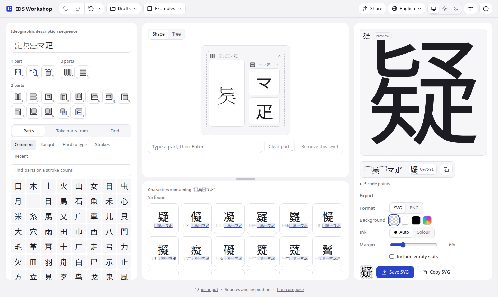
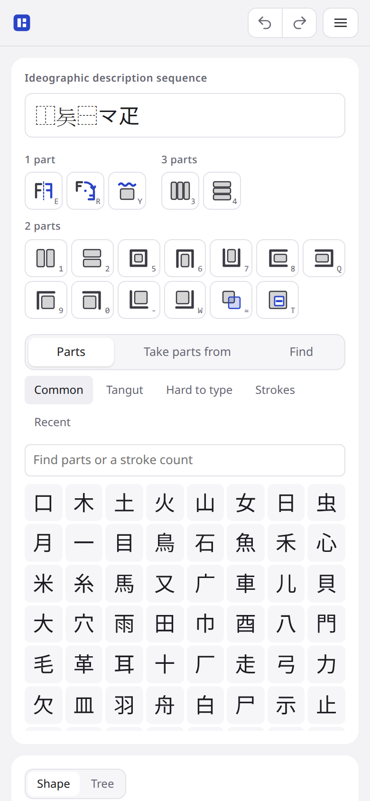
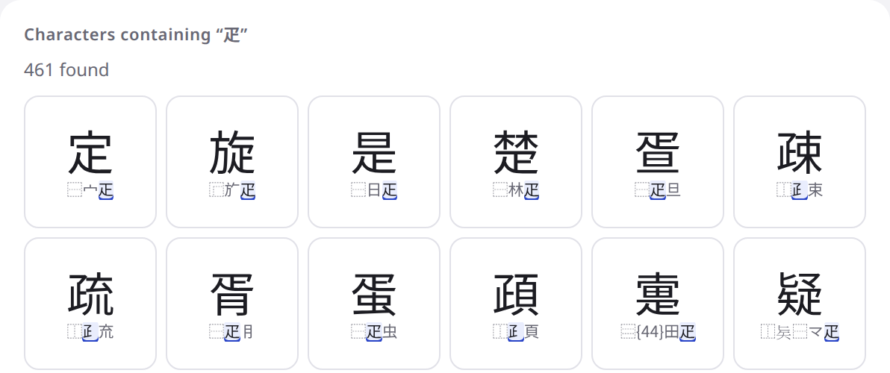
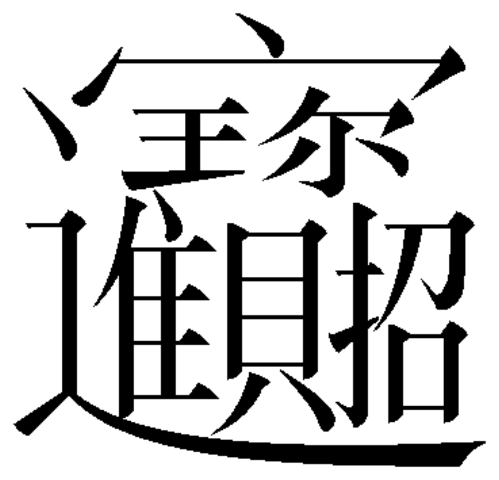

# ids-input

ids-input is a JavaScript library and a set of Svelte components for writing ideographic
description sequences (IDS), strings such as `⿰亻⿱七木` that describe a character by its parts.
Use it to write down a character that has no code point, to find characters by their parts, or to
put an IDS editor in a web page. It reads Han characters, those of Chữ Nôm included (𡨸 `⿰宁字`),
and Tangut characters and components.

Demo: the IDS Workshop, <https://ids.mkpo.li/>

<a href="https://ids.mkpo.li/"><picture>
  <source media="(prefers-color-scheme: dark)" srcset="docs/images/workshop-dark.png">
  
</picture></a>

The package has four layers, and an optional preview:

- **core**: framework-free JavaScript with types and no dependencies. It parses and writes
  sequences, edits them as trees (split, swap, unwrap, clear, undo), reads ASCII operator names
  (`LR` for ⿰), maps keys to operators, steps through decomposition trees, and finds components by
  the names, words and readings people use for them (絞絲, ノ文, 宝盖, water, のぎ), and a
  character by its readings or meanings.
- **document**: the layer model behind `.ids.json` documents: stable layer IDs, transforms, IDS
  import and projection, and identity-preserving edits. The editor does not use it yet.
- **adapter**: the data the components ask for, supplied by the host application. A default
  adapter reads BabelStone IDS, the parts palette, component forms, names, script folds and the
  character readings from static files, so nothing needs a server.
- **svelte**: Svelte 5 components over one editor model: the sequence field, the operator palette,
  the tree, the chosen part's tools, the part pickers (a parts palette, structure templates, a
  "Take parts from" decomposition browser, a search over components and characters, and a pad to
  find a part by drawing it) and the preview, each placeable on its own
  or together as `IdsInput`, with message catalogues in English, Japanese, Simplified Chinese,
  Traditional Chinese, Korean and Vietnamese.
- **composer** (optional): a preview that draws a sequence, empty slots included, with
  [han-compose](https://github.com/mkpoli/han-compose) in a Web Worker.

The bundled data holds BabelStone's Han and Tangut decompositions and unannotated descriptions
from Yi Bai's IDS dataset, and the palette has a Tangut
tab. Bopomofo outlines are bundled for preview and SVG/PNG export. Import `fonts.css` for Tangut
and New Korean text. Tangut outlines are bundled for previews and SVG/PNG
export; mixed Han–Tangut descriptions also use the host's han-compose dataset.
The Hangul tab has Jamo, Compose and Syllable views. Compose is one jamo keyboard of modern and
historical forms, grouped by consonants, vowels and finals: click an initial consonant, a vowel and
an optional final, and Insert puts the precomposed syllable or the Old Hangul jamo run into the
editor. Syllable searches the 11,172 modern syllables by character, jamo,
[Revised Romanization](https://www.korean.go.kr/front_eng/roman/roman_01.do) (or normalized
[McCune-Reischauer](https://en.wikipedia.org/wiki/McCune%E2%80%93Reischauer) initials and breves) or
code point; the romanization is a syllable spelling without the assimilation rules that cross
syllable boundaries.

The Shuishu tab holds the 486 characters and 47 radicals of the proposed block, at its tentative
allocations U+1B300–U+1B4E5 and U+1B500–U+1B52E. Unicode 18.0.0 leaves them unassigned too; the
outlines are the glyphs of the amendment's own code charts, bundled for previews and export with the
`IDS Shuishu` face, and the tab filters them by name, reading, meaning and code point. Its groups
follow the dictionary the index comes from: the characters that dictionary numbers, the rest, and the
radicals.

<picture>
  <source media="(prefers-color-scheme: dark)" srcset="docs/images/phone-dark.png">
  
</picture>

## Install

```sh
bun add ids-input      # or npm install ids-input
```

The Svelte components need `svelte` 5. The core and the adapter run anywhere.

## Usage

### Svelte

```svelte
<script>
  import { IdsInput } from 'ids-input/svelte'
  import { babelStoneAdapter } from 'ids-input/adapter'
  import ja from 'ids-input/messages/ja.json'
  import 'ids-input/fonts.css'
  // Vite: serve the data files as assets and pass their URLs.
  import ids from 'ids-input/data/babelstone-ids.tsv.gz?url'
  import layers from 'ids-input/data/tangut-layers.json.gz?url'
  import additionalIds from 'ids-input/data/yi-bai-ids.tsv.gz?url'
  import projectIds from 'ids-input/data/ids-project.tsv.gz?url' 
  import components from 'ids-input/data/ids-components.tsv?url'
  import parts from 'ids-input/data/ids-parts.json?url'
  import forms from 'ids-input/data/component-forms.tsv?url'
  import names from 'ids-input/data/component-names.tsv?url'
  import folds from 'ids-input/data/component-name-folds.tsv?url'
  import characters from 'ids-input/data/character-vocabulary.tsv.gz?url'

  const adapter = babelStoneAdapter({ ids, layers, additionalIds: [additionalIds, projectIds], components, parts, forms, names, folds, characters })
  let value = $state('')
</script>

<IdsInput {adapter} char="疑" bind:value messages={ja} locale="ja"
  onuse={sequence => console.log(sequence)} />
```

`IdsInput` props:

| prop | | |
| --- | --- | --- |
| `adapter` | required | see [Adapters](#adapters) |
| `value` | bindable | the text in the field, `⬚` for each empty slot |
| `char` | | start from this character's first description when `value` is not a sequence |
| `onuse(sequence)` | | called with a whole sequence; the Use button shows only when given |
| `onchange(text, whole)` | | every change, and whether the sequence is whole |
| `messages`, `locale` | | a catalogue from `messages/` (English fills any key it lacks) and its locale |
| `pickers` | `['find', 'parts', 'from', 'templates']` | the part picker's tabs; a tab the adapter cannot answer is left out; `templates` offers editable two- to four-part layouts and repeated rows |
| `recentKey` | `'ids-input.recentParts'` | `localStorage` key of the palette's recent parts; `null` keeps none |
| `keyHints` | `true` | show each operator's key in a corner of its button |
| `preview` | snippet | `(sequence, whole)`, drawn beside the field in place of `IdsPreview` |
| `tintMode` | `"hover"` | branch tints: `"hover"`, `"on"`, or `"off"`; also accepted by `createEditor` |
| `disabled` | | |

`IdsInput` shows `IdsPreview` beside the field when the adapter has a `preview` or a `drawing`.

The Templates picker groups layouts by component count and orders each group by the number of characters using it in the bundled BabelStone and Yi Bai IDS datasets. `scripts/build_structure_templates.mjs` adds layouts found in at least 50 distinct characters, preserving the original shortcuts. The Hangul layout `⿱⿽⬚⬚⬚` is included separately as a curated template; its tooltip identifies the layout rather than showing a Han-corpus count. The two mirrored pairs `⿰⬚⿾⬚` and `⿰⿾⬚⬚` are curated for the 対称 arrangement ([畳字](https://wikiwiki.jp/myriadrevery/畳字)), where the frequency pass leaves unary transforms out. Counts use supplied whole-character descriptions with two to four components, merge equivalent axis arrangements, and count each character once per layout. Source versions, counts and examples are recorded in `src/core/structure-templates.json`; these are dictionary coverage counts, not usage frequencies.

A host laying the editor out itself makes one editor and places its parts where it wants them; the
workshop in `demo/` does so:

```svelte
<script>
  import { IdsOperators, IdsPartTools, IdsPicker, IdsPreview, IdsSequence, IdsTree, createEditor } from 'ids-input/svelte'
  const editor = createEditor(() => ({ adapter, messages: ja, locale: 'ja' }))
  editor.reset('⿰亻⿱七木')
  let drawing = $state(null)   // the preview's drawing, for export (drawingSvg in the core)
</script>

<svelte:window onkeydown={event => editor.keydown(event, { root: document.body })} />
<IdsSequence {editor} />
<IdsOperators {editor} />
<IdsTree {editor} />
<IdsPartTools {editor} />
<IdsPicker {editor} pickers={['parts', 'from', 'find']} />
<IdsPreview {adapter} tree={editor.tree} chosen={editor.chosen} bind:drawing />
```

The editor holds the tree, the chosen part and a history of named steps (`editor.steps`, "Split ⬚
with ⿰", "Put 木"): `operator`, `put`, `take`, `empty`, `remove`, `open`, `undo`, `redo`, `travel`
and `keydown` change it, `change` names the last change and whether it threw something away, and
`listen(fn)` hears each new text. `snapshot()` returns that state and history; `restore(state)` puts
them back, for a host switching between documents. In the tree, a click chooses a part, a part
dragged from the palette, the decomposition tree, a search or the swaps is put where it is dropped,
and the context menu (right click, the Menu key or `Shift+F10`) splits or swaps with any operator,
clears, removes a level or copies that part's sequence. "Take parts from" reads a character dropped
on it.

The sequence field accepts zi.tools replacement expressions with three single components, such as
`🔄林木火` or `RP林木火`. It opens the source character's descriptions and converts the expression
to an editable IDS (`⿰木火`). The lookup opens as few components as possible, then replaces the
shallowest occurrence; where several are equally shallow, the last is used. If the target cannot be found in the available descriptions, the entered text
remains in the field. Resolution is bounded to eight opened components and 128 candidate trees.

`IdsParts` (`adapter`, `onpick(part)`) and `IdsFrom` (`adapter`, `ontake(text)`, bindable `text`)
also work without an editor. `IdsSketch` (`adapter`, `onpick(part)`, `onclose()`) is the Find tab's
drawing pad; it asks the adapter for the palette and takes its glyph shapes from the page's
`--ids-font`. The Components panel shows the most used parts first, then every Han
component of one stroke count, including compound IDS, grouped by first stroke. Palette text can be selected and copied;
compound cells show their sequence and expose the stroke count on hover. `adapter.icon` supplies their outlines;
without it, the cells use a font-based layout. Icon rendering must accept concurrent
requests independently of the main preview. The components take colours from CSS custom properties with light and dark defaults
(`--ids-ink`, `--ids-muted`, `--ids-line`, `--ids-surface`, `--ids-accent`, `--ids-fault`,
`--ids-font`, `--ids-glyph-fallback` and others; see the top of each component's style). The defaults
use `light-dark()`, so the page needs `color-scheme: light dark` for its dark scheme.

### Core

```js
import { parse, write, applyOperator, unwrap, unalias, commandFor, createHistory, enclosedRepeatSequence, pyramidRows, pyramidSequence, repeatSequence } from 'ids-input'

parse('⿰亻⿱七木').tree        // { op: '⿰', parts: ['亻', { op: '⿱', parts: ['七', '木'] }] }
parse('⿰亻').problem           // 'missing'
parse('⿰亻', { open: true })   // a draft: { tree: { op: '⿰', parts: ['亻', null] } }
write(applyOperator(parse('⿰亻失').tree, [1], '⿱').tree)  // '⿰亻⿱失⬚'
unalias('lr亻ud匕失')           // '⿰亻⿱匕失'
commandFor({ key: '&', code: 'Digit1' })  // { command: 'operator', op: '⿰' }, on any layout

pyramidSequence('口', 4)       // '⿱⿱口⿰口口⿱⿲口口口⿰⿰口口⿰口口'
pyramidRows(parse(pyramidSequence('口', 4)).tree)  // { cell: '口', layers: 4, count: 10, reverse: false }
pyramidSequence('⿱众⿰众众', 2) // '⿱⿱众⿰众众⿰⿱众⿰众众⿱众⿰众众', a description repeated
pyramidSequence('', 3)         // '⿳⬚⿰⬚⬚⿲⬚⬚⬚', empty slots to fill
repeatSequence('口', [2, 3])   // '⿱⿰口口⿲口口口'
repeatSequence('口', [2, 1, 2])  // '⿳⿰口口口⿰口口'
enclosedRepeatSequence('囗', '口')  // '⿴囗⿱⿰口口⿰口口'
repeatSequence('屮', [3, 3], { bottom: '刀' })  // '⿱⿲屮屮屮⿲刀刀刀'
```

A component is a graphic Unicode code point (letter, mark, number, punctuation or symbol) or a
private-use character, with an optional variation selector. A run of conjoining Hangul jamo that
forms one syllable is one component; the Hangul palette writes modern combinations as a precomposed
syllable and Old Hangul as the jamo run that fonts shape as one syllable. This includes 〇, Greek and Cyrillic
letters from every block, and scripts beyond CJK. Operators, empty-slot markers, whitespace,
controls, default-ignorable characters, surrogates and unassigned code points are excluded, except for the bundled Small Seal
allocation U+3D000–U+3FC3F, the New Korean Orthography code points U+A97D–A97F, U+D7C7 and U+D7FC–D7FE,
and the proposed Shuishu block U+1B300–U+1B4E5 and U+1B500–U+1B52E.
A combining mark fills an operand slot when one is due, and trails the whole description when the
description is complete; only a variation selector attaches to the preceding component. Acceptance follows bundled Unicode 18.0.0 property tables and is independent of
preview font coverage. The composer supplements missing export glyphs with 56,651 bundled font
outlines, including 〇, 〆, Greek, Cyrillic and other scripts. `fonts.css` offers the same outlines
to text as the `IDS Fallback` webfont, placed after the reader's fonts, so a character no installed
font draws appears in its shape rather than a missing-glyph box. Characters absent from both sources
still have no preview; private-use characters need an outline supplied by the host.
`isLetter` identifies alphabetic/syllabic letters and decimal digits, excluding ideographs and radicals.
The seven code points above are the positions OBAYASHI Muneaki proposed for the four letters the
New Korean Orthography added to Hangul in [L2/19-230R](https://www.unicode.org/L2/L2019/19230r-six-hangul-letters.pdf)
(2019-06-24); Unicode 18.0.0 leaves them unassigned. The Hangul palette names them, `fonts.css`
supplies the `IDS New Korean` face, and their outlines are bundled for previews and export.
The [Unicode IDS grammar](https://www.unicode.org/versions/Unicode17.0.0/core-spec/chapter-18/)
supplies the ideographic operands; the other graphic categories are this editor's extension. In a draft, `⬚` (or a part missing at the end) is an empty slot; a pasted `＋`, as earlier drafts and links have it, reads as one too, and is written back as `⬚`.

### Cells

A description of eight or more leaves (an empty slot counts as one) is drawn **in cells** when no
character spells it as a whole, it uses only alignment and exact enclosure operators, and every leaf
has a glyph. Each part takes its own cell in the tree's reading order, so no two parts overlap. The
cell layout gives a single top part less than a third of the height and lets it fill the width,
shares an alignment axis below the top by the ink of its parts (one holding an empty slot keeps leaf shares), insets a side-split enclosure's inner part and a three-row middle,
and fits each glyph by its ink. A dense description then reads as one character rather than a list
of parts. The 108-stroke created character 「ぼんのう」 by しょかき is
such a description; its [reference drawing](https://wikiwiki.jp/sosakukanji/%E3%81%BC%E3%82%93%E3%81%AE%E3%81%86%28%E3%81%97%E3%82%87%E3%81%8B%E3%81%8D%29)
puts 苦 above, 耳/舌/鼻 left, 平/惡/意/眼 centre, 淨/染 below and 女/子/身 right.

The preview badges a cell drawing **Cells**. `compose(source, sequence, { layout: 'composed' })`
forces the composer, and `'cells'` forces cells and rejects loose marks and modified operators; the default, `'auto'`, uses
cells only for such dense descriptions. A description that is itself a pyramid, a grouped form or
an excluded character, or that carries loose marks or approximate operators, keeps the composer.

### Pyramids

`pyramidSequence(part, layers)` writes one part in rows of 1, 2, 3, …; the part is a component, any
description or ⬚. `pyramidRows` reads an equivalent tree back, whichever way its rows use `⿰`/`⿲`
and its stack uses `⿱`/`⿳`, and answers the repeated part in `cell`. The composer draws a pyramid of
three or more rows as equal square cells in centred rows, so the 4-row spellings given for `口`
above draw alike, and deeper triangles keep the same cell size; a cell that is a description is
composed inside its cell. A whole description may run past the ordinary 64-code-point length as a
pyramid of two or more rows, its cells any part; a draft may be longer still. The composer draws up
to 64 rows (2,080 cells). The workshop's Templates tab inserts one-click pyramids of 2 to 24 rows,
its sizes in a scrollable row. The shared Part field above the generators starts with the selected
part or 口; an empty Part lays out empty slots, and a typed value is kept for all three. Enter a
part, then choose a preset or a custom row count.
Its Reverse toggle arranges rows from widest
to narrowest while keeping each part upright. `pyramidSequence(part, layers, { reverse: true })`
writes that arrangement; `pyramidRows` reports its direction in `reverse`.

### Repeats

`repeatSequence(part, rows, { bottom })` writes two or three rows of repeated parts, with one to
four copies in a row; a part is a component, any description or ⬚. The first rows hold `part`; the
last holds the second part, which defaults to `part`. Rows of three use `⿲`, a row of four splits in half, and the rows stack with
`⿱`. `repeatSequence('口', [2, 1, 2])` writes 2·1·2 as `⿳⿰口口口⿰口口`. `enclosedRepeatSequence(host, part)` puts four
copies in a 2×2 grid inside an enclosure.

The Templates tab inserts the 2+3, 3+3, 2+4 and 4+4 patterns with the shared Part field. A second
field, Bottom row, takes another part and falls back to the first when empty. A Rows
field takes two or three counts from 1 to 4, such as `3 4` or `2 1 2`. The Five block adds 2·1·2 and 1 + 2 × 2; its Host field is the enclosure. These cover the
五同, 六同, 八同 and 二組 arrangements of [畳字](https://wikiwiki.jp/myriadrevery/畳字).

### Loose marks

A description may end with a run of loose marks: combining marks, modifier letters, tone marks,
kana voicing marks or superscripts that annotate the whole character instead of taking an operand's
place. They are ordinary Unicode characters, not operators.

| written | drawn |
| --- | --- |
| `⿰亻木ˊ` | 休 with an acute tone mark |
| `⿰ㄅㄚˇ` | a Bopomofo syllable with the third tone |
| `⿰ㄅㄚ˙` | the same with the neutral tone dot |
| `⿰氵青゛` | 清 with a voicing dot (U+309B) |
| `⿰氵青゙` | the same with the combining U+3099 |
| `⿰亻木́` | an accent combining over the composed character |
| `⿰ㄅㄚ〮` | a Hangul single dot tone mark at the left |
| `⿸广⿰KO¹` | the 慶應 ligature with a superscript numeral |
| `⿰亻木˥˧` | tone letters after the character |

`isMark` names the characters that may trail a description: every Unicode mark (Mn, Mc, Me), every
modifier letter (Lm), the modifier symbols for accents and tone letters (Sk: `˙ ˪ ˫ ˥–˩`, `꜀–꜇`,
`゛ ゜` and the like), and superscript or subscript digits (No). `parse` keeps them on the root, as a
node's `marks` or the tail of a component's text, and `write` puts them back; `splitDescription(text)`
answers `{ base, marks }`. A mark written where an operand is still due fills that operand, as it
always could, so `⿰ㄅˊ` stays a two-operand description. The marks belong to the whole description:
an edit that would leave them inside the tree moves them back to the root (`normalizeMarks`).

Type or paste the marks after a complete description in the sequence field, or pick one from the
Marks tab of the parts palette; the Bopomofo and Hangul tabs keep their tone marks. Loose marks are
not part of an IDS shape, so search ignores them: `⿰亻木ˊ` finds what `⿰亻木` finds. In a
`.ids.json` document they are `marks` on an operator or the end of a component's `char`, at the end
of the projection.

The preview draws marks into the same 1000-unit box:

- a combining mark sits over or under the composed drawing, centered, and a run stacks; it may
  overlap the ink, as a combining mark does over its base;
- a mark that sits beside the drawing takes a margin: kana voicing marks, spacing accents, tone
  letters and superscripts at the upper right in a row, Hangul tone marks at the left. The composed
  drawing shrinks toward the opposite corner so the mark stands outside its strokes, and the row or
  stack is fitted to its corner of the box;
- everything stays inside the box. A mark whose outline is in neither the host export nor the
  bundled Unicode outlines is left out of the drawing.

Marks are separate parts of the drawing (`origins` holds `mark ˊ`), so they export with the SVG and
PNG. The test suite draws them from the bundled Bopomofo and Unicode outlines.

A zi.tools entry reads as its description: the unique separator before it (`{士}⿱十一`) and the
glyph-variant definition after it (`⿻乚一(.,T)`) say which glyph the entry is for, so `parse`
leaves them out and `write` does not put them back; this package draws one glyph per character and
carries no variant data. A modifier after an operator (`⿻[1:]丨日`, `⿴[1]囗人`, `㇯[2]王一`)
stays with that operator and is written back with it: overlays, the enclosures and subtraction take
one, other operators keep a bracket as a component, and its matrix or index narrows where a part
sits or which occurrence an operator acts on. The layout draws the description as it does without
one, so previewing such a description is approximate. Stroke chains (`#(H)`) are not read yet.

A zi.tools stroke chain that names a stroke or a character reads as that character: `#(H)` is 一,
`#(Wg)` is ㇁, and `#(-丨𠃍-一z)` is 口. Chains that name no character the published grammar lists
stay in the text, to be read as their parts or rejected as usual.

A zi.tools description that carries a stroke chain this package cannot draw resolves to the
character the published table gives it: pasting `⿱丿⿹#(-𠃌㇉)一` gives 乌. The host supplies that
table as `chains` (the workshop's `data/zi-tools-chains.tsv.gz`); without it the text stays.


### Small Seal (小篆)

The optional `smallSealAdapter` provides CHISE's 汲古閣本《說文解字》 decompositions.
Its current Unicode mapping supports **49 character descriptions and 1,383 drawable palette forms**.
The workshop includes these in its searches and Small Seal palette. Searching for `玨`
finds its seal counterpart, U+3D10C; its description is `⿰𽁭𽁭`. Searching for
`𽄌` or `U+3D10C` returns its modern correspondences, 玨 and 珏. Character lookup
uses 1,402 mapped seal forms; some have no resolved decomposition or bundled glyph.

The Small Seal palette opens on 138 selected basic parts. Compound parts and
unclassified forms have separate groups. Type a modern character such as 木 or 口
to filter the seal palette. An `≈` marks grouping inferred from modern CJK IDS;
these estimates do not enter the seal decomposition table.

Dataset maintainers can generate an offline comparison gallery and validation
report with `node scripts/check_small_seal.mjs OUTPUT_DIRECTORY`. See the
[provider audit guide](docs/small-seal-candidates.md).

```js
import { smallSealAdapter } from 'ids-input/adapter'
import sealData from 'ids-input/data/small-seal.json.gz?url'

const adapter = smallSealAdapter({
  data: sealData,
  ids, parts, forms, names,
})
```

`data` accepts a URL or the decoded JSON document. The remaining options are those of
`babelStoneAdapter`; omit them to use Small Seal alone. All descriptions share one search index.
Component and IDS searches match mapped seal and modern forms in either direction:
`玉玉`, `𽁭𽁭`, and `⿰玉𽁭` can find the seal 玨. Mappings join the existing radical-form
groups; a seal form with several modern spellings makes those spellings match one
another too. Repeated components are counted across the group. These groups concern
glyph correspondence; modern spellings can differ in meaning.
Each script keeps its own decompositions, result glyphs, and exact `encoded()` lookup. Import `fonts.css` to display the supported
seal characters. Their bundled outlines support previews and SVG/PNG export; mixed
Han–seal compositions also need the host's Han export.

The source has 11,114 records. Unresolved identifiers, extended operators and missing
mappings remain in the downloadable data with their original text and status. They are
excluded from decomposition lookup. See [the data notes](data/README.md#small-seal) for coverage,
provenance and rebuilding. CHISE data is GPL-2.0-or-later; the font has separate terms.

### Documents

`ids-input/document` is the model behind the [document format](docs/document-format.md): a tree whose
layers have stable IDs, transforms and a rendering recipe, saved as `.ids.json`.

```js
import { fromSequence, toSequence, replaceWithSequence, writeDocument, readDocument } from 'ids-input/document'

const document = fromSequence('⿰木口')
toSequence(document.root)                       // '⿰木口'
const mouth = document.root.children[1]
const replaced = replaceWithSequence(document, mouth.id, '水')
document.root.children[1].char                    // '口'; the input document is unchanged
const file = writeDocument(replaced)
readDocument(file).root.id                       // 'root'
```

`fromSequence` gives every layer a fresh opaque ID; repeated characters get different IDs. The edit
functions (`replaceNode`, `replaceWithSequence`, `decompose`, `wrapNode`, `unwrapNode`,
`changeOperator`, `deleteLayer`) keep the selected layer's ID, name and transform. Pass one
allocator across a session (`allocatorFor(document, retainedIds)`) so a removed ID is not reused.

The model reads and writes the document shape and validates its structure and transforms. The
transform engine evaluates affine, projective and Möbius chains on paths: affine chains stay exact,
a nonlinear chain is flattened within a tolerance and its pole is checked against the path's control
hull. `renderLayers(document, source)` walks the tree with a host that supplies each component's
local geometry and each operator child's placement, applies the nested layer transforms, and reports
missing geometry or unsupported transforms. `renderScopes` keeps component cuts and operator children
apart; `scopesSvg` writes that tree with scoped masks, including ㇯ subtraction.

`createDocumentSession(document)` holds a document, the chosen layer ID and an allocator that never
reuses an ID. Its edits (`replace`, `decompose`, `wrap`, `unwrap`, `changeOperator`, `remove`,
`clear`, `setTransform`) keep the selected identity, and `undo`/`redo`, `snapshot`/`restore` work over
whole documents. `sync(tree)` reconciles an editor tree without clearing history when the tree is
unchanged; a structural change updates the document and clears the session history because the
editor owns structural undo. `setTransform` accepts a coalesce key, so one drag is one step.
`session.document` returns a detached copy; use session edits to change it.
`listen` tells a host when to redraw; a throwing listener is reported through
`onListenerError` (or `reportError`) and does not undo the committed edit.

`sessionRecord(session)` and `writeSession(session)` keep the document, chosen layer and every issued
ID for a tab or draft; `readSession(text)` restores them. The record omits undo history. The document
itself is the `.ids.json` file, written by `writeDocument` and read by `readDocument`.

`syncDocument(document, tree, { allocator })` reconciles the editor's positional tree into the
document at the same paths, keeping each layer's ID, name and transform through replacements and
structural edits. Pass the long-lived session allocator so removed IDs do not return.
`treeFromDocument` and `documentFromTree` convert between the two projections; `layerAtPath` and
`pathOfLayer` move between editor paths and layer IDs. `layerFrames(document, source, sketch)` gives
each layer's box, local-to-canvas frame and conversion frame for handles and fields. The workshop
keeps a session with each tab and saved draft, so the document survives reloads. The preview,
Adjust layout and export use that document, and a share link carries what the sequence cannot.

`documentSource(document, drawing, sketch)` turns a separated composer drawing into the geometry and
placement source the document renderer takes. `composeDocumentSource(document, preview)` draws and
builds it in one call; the preview must use `separate: true`. `documentView(document, drawing, sketch)`
adds the scoped drawing, frames and combined issues in one pass, for a preview that needs both the
picture and its handles. When the composer omits leaf ownership, the source infers it only from one
non-cut part per component in reading order; anything else leaves the source incomplete. Session
records live in [`src/document/store.js`](src/document/store.js); file bindings live in
[`demo/lib/documents.js`](demo/lib/documents.js).

## Adapters

```ts
interface IdsAdapter {
  structure(char, options?): Promise<{ text: string, regions?: string }[]>   // required
  variants?(part, options?): Promise<{ char: string, count?: number }[]>
  search?(query, options?): Promise<{ char: string, label?: string }[]>
  containing?(parts, options?): Promise<{ items: string[], more?: boolean }>
  parts?(options?): Promise<PalettePart[]>
  sketchTemplates?(options?): Promise<SketchTemplate[]>   // glyph shapes for the drawing search
  recognizeDrawing?(strokes: { x: number, y: number }[][], options?): Promise<string[]>  // whole characters, in percentage coordinates
  drawing?(sequence, options?): Promise<string | null>   // a final image's URL
  icon?(sequence, options?): Promise<Drawing | null>    // concurrent palette icons, separate from preview
  preview?(sequence, options?): Promise<Drawing>          // rejects when it cannot draw
}

interface SketchTemplate {   // a palette part as the drawing search sees it
  part: string
  strokes: number | null
  uses: number
  shapes: Shape[]            // the glyph stretched and at its own proportions
}

interface Shape {            // 40×40; see src/core/sketch.js
  mask: Uint8Array
  distance: Uint8Array       // distance from each cell to the ink
  gradient: Float32Array     // 5×5 cells of 8 stroke directions
  ink: number
  points: Uint16Array        // the ink cells
}

interface Drawing {          // in a 1000-unit box, y down
  d: string                  // the ink as an SVG path, nonzero fill
  cut?: string               // what ㇯ takes away
  slots?: { index: number, box: [x, y, width, height] }[]   // each empty slot (⬚), in reading order
  stroke?: [number, number] | null                          // stroke widths placeholders follow
  approximate?: string[]     // operators drawn by an approximation
  kanjivg?: boolean          // a part was cut along KanjiVG's groups (CC BY-SA 3.0)
}
```

`options` carries an `AbortSignal` (`signal`) and a `limit`. `structure` answers a character's
descriptions with the source regions each describes (`GHTJKPV`), and `[]` for a character with no
smaller parts. `variants` answers components that can stand in a part's place (コ for 龴).
`containing` answers the characters built from every part in its query, counted (`木木` asks for
two). `preview` draws a sequence that may hold empty slots (`⬚`); its options also carry
`onSketch(leaves)`, which hears where each part goes before the drawing is done. It rejects with an
Error named `TooLargeError` for a sequence larger than it draws, `UnavailableError` when its data
cannot be read at all, and any other Error when it cannot draw. `IdsPreview` shows placeholders in the layout's boxes until a drawing arrives, a badge
(Preview, Approximate, Final, Could not compose, Too large), and the adapter's `drawing` in place of
the preview when there is one. While the data is unavailable, the placeholders stand with no badge.

`IdsPreview` takes a tab `document` and `session` for direct layer editing, and binds `scopes` for
export. Drag the selected layer to move it, its corner square to scale it, or its circle to turn it;
each gesture writes one coalesced document transform. Use `composerPreview({ base, separate: true })`
so each operand arrives as its own part. When the document source is incomplete the preview falls
back to the merged drawing, and editing is unavailable.

A separated drawing also feeds a document renderer: `documentSource(document, drawing, sketch)` keeps
each leaf's box as its local frame, or `composeDocumentSource(document, preview)` draws and builds the
source together. The composer's leaf ownership is used when present; without it, one non-cut part per
component in reading order is inferred. Other drawings report themselves incomplete.

`babelStoneAdapter({ ids, layers, additionalIds, overwrite, components, parts, forms, names, folds, characters, sketches })` answers
`structure`, `search` (a character, `U+6728` or bare hex, a name such as 絞絲, or a word or reading
such as water or のぶん when `names` is given, and the whole characters those names belong to when
`characters` is given), `containing`, `parts` and `sketchTemplates` from the files in `data/`.
`sketches` is the URL of `data/sketch-parts.json.gz` (or its decoded document), the prepared masks
the Find tab's drawing search uses. `components` writes
out BabelStone's numbered components (`{12}`, the
right of 龍, as `⿷己三`), so 龍's description reads `⿰𦚏⿷己三` and its parts can be taken
individually; `{82}`, the top of 書, writes out as the encoded 聿, so 書 reads `⿱聿日` and 畫 and 晝
reach the same 聿 that 建 and 律 use, through 𤱪 and 書. `additionalIds` adds tables in the same
format, one URL or an array: Yi Bai's descriptions and this project's own table for characters newer
than BabelStone's (currently empty; 𳑳, U+33473, is a 獨體字 and is not described); `overwrite` maps a
whole description to the encoded character it draws as (`⿰𦚏𳑳` as 龍). `forms` folds the
description search's components and opens a named component into the forms that stand for it;
`folds` folds Chinese scripts and positional forms together before names are compared. Without them
`⺡` and `氵` are different components and a name finds only the form and the script the table
records. The containing search builds an index in memory on first use: under Bun, about half a
second for the most frequent components and 150 MB of heap with the table loaded; a host with a
server can answer `containing` there instead. It has no `variants`, `drawing` or `preview`.

`layers` supplies a character-first Tangut description: the largest proper subtrees that spell another
Tangut character whole become those characters, and components that spell a one-component character
become it. 𗀃 reads `⿱𘠀𗸡`; opening 𗸡 reaches `⿰𘣣𘠐`, reconstructing BabelStone's description.
The tree marks the computed reading *Split by characters*. Characters without a computed description
keep their source description; malformed descriptions stay as source text. Both the computed and
source descriptions remain searchable. The computed reading follows shapes and does not assert a
recorded segmentation or historical descent.

Pass `additionalIds` as the URL of an IDS table in the same format, or an array of them, to add
descriptions without replacing BabelStone's. The workshop supplies `data/yi-bai-ids.tsv.gz`, Yi
Bai's unannotated standard subset, and its own `data/ids-project.tsv.gz` for characters newer than
BabelStone's (empty at present; the newer character 𳑳 is a 獨體字). Extended expressions and variant
annotations are not included.

## Search

`IdsStructuralSearch` provides whole-character structural search with examples for pyramids,
four-part grids, repeated pairs and triples, the larger repeats, mirrored pairs, matching
outer parts, enclosures and overlays.
The demo offers it beside the existing character search below the editor. Selecting a preset
runs the search; the pattern can then be edited. Results open in the editor, and **Copy all
characters** copies the complete result, including hits beyond the visible page.

**Similar structures** lists the characters whose description has the current description's
operator and at least one of its operands in the same place, the other operand free:
`⿱木口` (杏) finds 森 for `⿱木？` and 占 for `⿱？口`. The character the description already
names stays out. It reads the adapter's `findSimilar`, which asks the same index once for each
operand; a description without an operator has none.

```js
import { createStructuralSearch, readStructuralForms } from 'ids-input'
const structuralForms = readStructuralForms(formsText)
const patterns = createStructuralSearch(table, { forms: structuralForms })
patterns.search('⿱A⿰AA')          // 品, 森, 麤, …; A must be the same component
patterns.search('⿱⿰AA⿰AA | ⿰⿱AA⿱AA') // both four-part grid orientations
patterns.search('⿲ABA')           // matching outer parts, such as 弼
patterns.search('⿸⬚⬚')           // any upper-left enclosure
```

A–Z bind components or subtrees; repeated letters must have a common compatible decomposition.
Different letters may match the same part. Structural forms accept Unicode equivalent ideographs and explicitly positional forms.
Broad radical variants stay distinct: 𡿨, 巜 and 巛 have different multiplicities,
and 丿/乀 and 𠄌/亅 differ in direction. `createSearch` accepts a separate
`structuralForms` map (strict equality by default); ordinary component search
continues to use its broader `forms` map.
`⬚` and `？` match any part; `|` separates up to eight alternative patterns. Each pattern must
be a complete IDS of at most 64 code points. Matching starts at the character's whole description
and opens encoded components up to six levels, considering source alternatives. It does not find
a pattern merely contained somewhere inside an unrelated outer structure. Approximation marks
remain explicit operators. Coverage depends on the supplied descriptions and forms.

`babelStoneAdapter.findByStructure(query, { limit, signal })` runs this search in the same worker
as description search. It returns `{ hits, total, characters, problem? }`: `characters` contains
all matching characters without separators, while `hits` is limited for display. Invalid patterns
return `problem: 'pattern'`. Results put common unified ideographs first, then Extension A, then
other characters, with code-point ordering within each group.

`createSearch(table, { forms })` in the core finds characters by what their descriptions hold, and
`babelStoneAdapter` answers it as `findByIds(query, { limit })` over its table. `IdsSearch` lists the
hits as square character cards, the code point shown on hover; the workshop puts it under the tree and
searches for the selected part, or the whole tree when nothing is selected. Each operator frame
shows its subsequence in muted text. Selecting an empty slot clears the search, except when one
side of a `㇯` expression names a component, in which case the whole expression is searched.

To find characters containing 木, use `㇯⬚木`; to list the components of 森, use `㇯森⬚`.
The empty slot works as a wildcard in both searches. The zi.tools spellings `㇯？木` and `㇯森？`
also work, and `SU` can be used in place of `㇯`. These searches use the adapter's own data;
components hidden inside a subtraction are omitted because the data does not establish which survive.
For a structural search of a subtraction with a wildcard, use the structural-search mode, or pass
`{ componentLookup: false }` to `createSearch().search()` or `adapter.findByIds()`; the latter
also finds matching subtrees inside a character.

IDS queries accept visual substitutes. The kana families follow the encoded
components in the [葦手入力 correspondence table](https://ashide.otodo.net/setumei/ziboziso.html)
and its [learning guide](https://ashide.otodo.net/setumei/tebiki.html).
All 46 basic kana are covered; the table below lists their search alternatives.

| Kana | Components | Kana | Components |
|---|---|---|---|
| ア | 了 ㇌ 卩 刀 丫 | イ | 亻 𠂆 人 入 㐄 井 |
| ウ | 宀 | エ | 工 |
| オ | 才 扌 | カ | 力 尸 |
| キ | 十 弋 | ク | 𠂊 勹 |
| ケ | 亼 个 | コ | 凵 囗 〇 |
| サ | 卄 廾 艹 䒑 | シ | 氵 辶 辶 丨 |
| ス | 大 丌 | セ | 七 土 士 廿 |
| ソ | 丷 | タ | 夕 月 |
| チ | 千 干 | ツ | 灬 小 川 巛 𫶧 |
| テ | 亍 于 | ト | 卜 ⺊ 𠂉 |
| ナ | 𠂇 | ニ | 二 |
| ヌ | 又 | ネ | 礻 |
| ノ | 丿 ㇢ 亅 | ハ | 八 |
| ヒ | 匕 匚 匸 | フ | 乛 丆 厂 |
| ヘ | 乀 乁 一 ㇀ | ホ | 木 朩 𣎳 |
| マ | 龴 丅 丁 | ミ | 三 彡 |
| ム | 厶 | メ | 乂 |
| モ | 乇 王 壬 | ヤ | 巾 㔾 |
| ユ | 丄 亠 | ヨ | 彐 ⺕ 日 |
| ラ | 广 | リ | 刂 |
| ル | 儿 几 𠘧 | レ | 𠄌 ㇗ ㇄ 乚 𡿨 乙 |
| ロ | 口 | ワ | 冖 冂 |
| ヲ | 丩 丬 山 屮 | ン | 冫 丶 |

`ヰ` also searches for `井`. Hangul aliases remain available:
`ㅅ → 人`, `ㅆ → 从`, `스 → 亼`, `ㅁ → 口`, `ㅇ → 〇`,
`ㅣ → 丨`, `ㅡ → 一`, `ㄱ → 𠃍`, `ㄴ → 𠃊`, and `ㄷ → 匚`.
Conjoining jamo and corresponding halfwidth forms work too; decomposed `스`
searches like `스`. Attached variation selectors are preserved. Kana followed
by a voicing mark keep their literal search behavior.

Each shape requests one of its alternatives. For example, `⿰イ木` can match
`⿰亻木` or `⿰井木`; `イイ` needs two matching components, and `イ人` cannot
reuse one `人` for both requests. Literal Han queries retain their distinctions.
The original IDS and result descriptions remain unchanged.

This is component and structural search using Ashide's shape families. Its
five-keystroke selection rules and unencoded stroke fragments are outside this
search table. Direct insertion, name lookup, rendering, and exact `encoded`
lookup retain their existing behavior.

<picture>
  <source media="(prefers-color-scheme: dark)" srcset="docs/images/search-dark.png">
  
</picture>

- A term starting with an operator (or its ASCII name) is a structure, matched wherever its shape
  stands in a character's description, at any depth, components opened into their own descriptions
  as needed: `⿱木⿰木木` finds 森 (`⿱木林`, 林 being `⿰木木`).
- An empty slot (`⬚`, or a pasted `＋`) or `？` in a structure matches any part, a component or a
  whole subtree.
- Any other term is a run of components the character must hold, at any depth, counted: `木木`
  finds 林 and 森 but not 本.
- Terms apart by spaces must all match: `⿰？？ 氵` finds characters split left and right that hold 氵.
- Components match across their radical and positional forms (⺡, 氵 and 水 are one), from
  `data/component-forms.tsv`; ⿻ matches its parts in either order.
- Hits come closest first: the whole description matched exactly, then by how deep the match lies,
  how many components had to be opened to reach it, how many of a run's components stand in the
  description itself, how many parts the description has, and the common ideographs before the
  rarer blocks. Each hit carries the description it matched in, opened where the match needed it,
  and the spans the terms matched, which `IdsSearch` marks.

`findByIds` builds its index once in a Web Worker, which fetches the table and the forms itself. On
the full table (97,680 characters) under Bun 1.3.14 on an AMD Ryzen 7 9800X3D, building it took
1.4 to 2.1 s and 55 to 65 MB of heap over several runs. A query naming components answers in
1 to 35 ms (`⿱木⿰木木` 15 to 33 ms, `日月` 8 ms, `⿰⺡木` 17 to 35 ms); the broadest wildcard queries
take longer (`⿰？木` 0.2 to 0.3 s, `⿴囗？` 0.4 to 0.5 s, `⿰？？`, which matches 91,193 characters,
0.6 to 1 s). In the workshop under headless Chromium, a fresh page showed its first results 3.4 to
5 s after navigation over three runs, the table's download and parsing included. Without a Worker (Bun, tests) the search runs on the caller's thread.

### Names and vocabulary

The parts finder's Find tab asks the adapter's `search`; with `names` it takes a character, a code
point, a name, a word or a reading (`data/component-names.tsv`, 6,642 names, words and readings
from Japanese and Chinese radical dictionaries and Wikidata, with English glosses, pinyin, Hepburn
and Kunrei romaji, and Korean and Vietnamese readings). A query and every name are folded alike:
NFKC, katakana as hiragana, Latin accents off, spaces and punctuation out, and Chinese scripts
through `data/component-name-folds.tsv`. A name that is the whole query comes first, then one the
query starts, then one it stands inside, so 宝盖 finds 宝盖 and 宝盖头, and 絞絲 finds 絞絲旁. A Latin
query matches whole words and their starts, and a word of five letters or more may stand inside a
longer name.

The component a name finds is opened into its other forms through `component-forms.tsv`, keeping
those the parts palette holds: 絞絲 and 绞丝 offer 纟, 糹 and 糸; ノ文, ノブン and のぶん offer 攵
and 攴; ノ木, の木, ノギ and のぎ offer 禾; 宝盖 and 寶蓋 offer 宀; 倒八 offers 丷, 卷字头 offers
龹, and 石字头 offers 丆. Either Chinese script finds either: 寶蓋, 宝盖, 寶盖 and 宝蓋 all give 宀,
and 龍部, 龙部 and 竜部 all give the forms of 龍. Readings, pinyin, romaji, Korean, Vietnamese and
English senses work the same way: water, silk, roof, thread, person, みず, mizu, sui, shui,
jiaosipang, baogaitou, sandianshui, nobun, nogi, ukanmuri, 수, thủy and Bộ Thủy lead to their
components; `radical 120` and `Kangxi radical 120` lead to 糸. A single ideograph typed on its own
stays the character it is; a lone kana also searches names, so き finds 生, as does a lone Hangul
syllable, so 수 finds 水. Without `names` the search takes characters and code points only.

With `characters` (`data/character-vocabulary.tsv.gz`, every IDS character with a Unihan or
KANJIDIC2 name: 48,966 characters, 214,533 readings, pinyin, romanizations, Korean, Vietnamese and
English meanings), the same search also offers whole characters after the components and the
characters the relations already know: roof finds 宀 and then 屋, silk finds 丝, 絲 and 糸 and then
絹, and thuy finds 水 and then 始. Among equally close names the more common character comes first,
by KANJIDIC2's newspaper frequency or Unihan's school grade.

### Drawing a part or character

The Find tab has a pen beside its field. Draw a part or character in the box, and the tab lists the
characters the adapter recognizes and the palette parts whose shapes are closest; picking one puts
it in the chosen slot, like a typed find. The parts are compared with 803 palette parts and the CJK
strokes, each fitted to a square twice.

`babelStoneAdapter({ sketches })` takes `data/sketch-parts.json.gz` (or its decoded document), and
the workshop passes it: the pad opens from 104 KB of prepared 40×40 masks, independent of which
fonts the page has loaded. Without `sketches`, the same shapes are drawn from the page's
`--ids-font` when the pad opens, which needs its CJK faces loaded; a part a font draws as its
missing-glyph box is left out either way. Nothing is sent anywhere.

Parts within one stroke of the drawing's count, or two when the drawing has one or two strokes,
come before the rest; within that, the closest shapes come first by how far each shape's ink lies
from the other's and by a coarse histogram of stroke directions. The match is approximate: it looks at outlines, not stroke order, so simple
parts such as 口, 木 and 氵 work best, and a part drawn with unusual proportions may rank below a
similar one. `IdsSketch` is the pad; `shapesOf` and `rank` in the core do the comparison,
`readSketchTemplates` decodes the prepared file, and `sketchTemplates` in the Svelte layer draws
the fallback from the page's fonts.

`adapter.recognizeDrawing(strokes)` optionally names whole characters, closest first, from strokes
in percentage coordinates. The workshop implements it with DaKanji's 6,507-class Japanese
classifier (MIT; trained on ETL and KanjiVG; `demo/model/`), served with ONNX Runtime Web and
loaded on the first drawing: 2.2 MB of model and 12 MB of WebAssembly, outside the package. On
the 20 synthetic stroke drawings in `demo/model/benchmark.json`, 19 put the drawn character in the
top 24 and 18 in the top 10.
Chinese-only forms are not in the model's labels; the palette parts remain their fallback. A host
without `recognizeDrawing` gets the parts alone, and a failed or empty recognition falls back to
them.

## Preview

`ids-input/composer` draws sequences with han-compose (<https://github.com/mkpoli/han-compose>,
MIT), ported to the browser. Tangut, Bopomofo, Small Seal and Unicode fallback outlines are
bundled and loaded on demand. Han and mixed descriptions also read the static files han-compose's `export-web` writes (format 5):
a manifest, the learned layout, and the records of every character and the host lists of every
(place, operand), packed into gzipped shards by the first three hex digits of their SHA-256
(`g/<hhh>.json`, `p/<hhh>.json`), so a sequence loads only the shards its parts fall in. An export that
carries no host list has no part to cut; its descriptions are laid out by the composer's plain shares
instead of the learned boxes, which are where cut parts go. Drawing runs in a Web Worker,
one sequence at a time; a newer sequence ends the drawing before it.

```js
import { composerPreview } from 'ids-input/composer'

const adapter = { ...babelStoneAdapter({ ids, parts }),
  preview: composerPreview({ base: 'https://example.org/composer/<version>/' }) }
```

`base` is the folder holding the export's `manifest.json`. The host serving it must allow the page's
origin by CORS. If the export is unavailable, descriptions whose parts all have bundled outlines
can still render. Other previews keep their placeholders. When the export loads but a part has
no outline in either source, its badge reads
"Could not compose". Sequences over 24 operators or 8 levels are not drawn, except pyramids of up
to 64 rows, which are laid out as equal cells. Under
Vite, keep the package out of dependency pre-bundling (`optimizeDeps: { exclude: ['ids-input'] }`)
so the worker's URL resolves; `composerPreview({ base, worker })` takes a function making the Worker
for other bundlers.

`fromUrl(base)` uses a selected export's own glyphs first, then loads bundled fallback glyphs for
missing components. `unicodeSource()` supplies only bundled Unicode glyphs with geometric layout.
For Node, pass `unicodeSource({ load })`, where `load('unicode/030')` returns the parsed records
from `data/unicode-outlines/030.json.gz`; Node's fetch does not read local file URLs.
`hasUnicodeGlyph(component)` reports exact bundled coverage. Fallback glyphs are monochrome,
with the source font's design; they do not imitate a selected serif or handwritten face.

The demo draws Sans from `https://glyphatlas.org/atlas/composer/bd0829bc6fbf-sans-compose-layout-v4-f5/`,
Serif from the serif export, and Kaisho from the Kureedo export; `?composer=<url>` or
`VITE_COMPOSER_BASE` points every face at another copy of one export. A face that cannot draw a
description draws the encoded character it names in that face, else the Sans export's drawing.

## Keyboard

On the tree (outside text fields), keys go by where they sit, so every layout has them:

| keys | |
| --- | --- |
| `1`–`9`, `0`, `-`, `=` | ⿰ ⿱ ⿲ ⿳ ⿴ ⿵ ⿶ ⿷ ⿸ ⿹ ⿺ ⿻ |
| `q` `w` `e` `r` `t` `y` | ⿼ ⿽ ⿾ ⿿ ㇯ 〾 |
| `Tab`, `Shift+Tab` | the next and previous part |
| `Backspace`, `Delete`, `?` | empty the chosen part |
| `Ctrl/⌘+Z`, `Ctrl/⌘+Shift+Z`, `Ctrl/⌘+Y` | undo, redo |
| `Menu`, `Shift+F10` | the chosen part's context menu |
| any other character | goes to the part field; `Enter` puts it in the slot |

Elsewhere, `Ctrl/⌘+S` saves a draft and `Ctrl/⌘+,` opens settings. Toolbar buttons show their keys
on hover. Outside text fields, `Ctrl/⌘+X`, `Ctrl/⌘+C` and `Ctrl/⌘+V` cut, copy and paste the selected
part (the whole sequence when none is selected); `Ctrl/⌘+A` selects the whole tree. File and Edit
menus support arrow keys, Home/End and Escape.

The operator palette groups the operators by how many parts they take (1: ⿾ ⿿ 〾; 2: ⿰ ⿱ ⿴ ⿵
⿶ ⿷ ⿼ ⿸ ⿹ ⿺ ⿽ ⿻ ㇯; 3: ⿲ ⿳, `OPERATOR_GROUPS` in the core), each button showing its key (`shortcut()` writes keys as the platform does: ⌘⇧Z on Apple systems,
Ctrl+Shift+Z elsewhere). After them a ⬚ button empties the chosen part, as the part tools' Clear part does, and shows `?`.

An operator on a slot splits it, the old part first (⿰ on 失 gives ⿰失⬚); on an operator it takes
its place and keeps its parts, refusing to drop a filled one. In the sequence field, ASCII names in
either case become operators: LR ⿰, UD ⿱, LL ⿲, UU ⿳, OC ⿴, OD ⿵, OU ⿶, OR ⿷, RD ⿸, LD ⿹, RU ⿺,
XX ⿻, OL ⿼, LU ⿽, MI ⿾, RO ⿿, SU ㇯. Two capitals that spell a name are read as that operator, so
letters such as L and R side by side go in from the part field, one slot at a time. In "Take parts from", the arrow keys move through the tree,
`ArrowRight` opens a part and reaches its swaps, and `Enter` takes a part or a whole node.

## Licences

- Code: MIT (`LICENSE`).
- `data/small-seal.json.gz` and `data/small-seal-sources.tar.gz`: CHISE, GPL-2.0-or-later
  (`data/COPYING-small-seal.txt`).
- `data/seal-sources.txt.gz`: Unicode SealSources, Unicode-3.0
  (`data/COPYING-seal-sources.txt`).
- `fonts/IDSSeal*` and `data/small-seal-outlines.json.gz`: derived Kaiyuan glyphs under
  the [Kaiyuan font license](fonts/LICENSE-IDSSeal.txt); the outline file also contains
  exact-description mappings from CHISE (GPL-2.0-or-later).
- `data/babelstone-ids.tsv.gz`: BabelStone IDS, public domain, with the 6,145 records of BabelStone
  Tangut IDS, factual decompositions (798 KB).
- `data/tangut-layers.json.gz`: the largest character split of 2,408 Tangut descriptions, computed
  from those public-domain decompositions (16 KB); it adds no source and records no descent.
- `data/ids-components.tsv`: BabelStone IDS.TXT note 6's numbered components and the IDS fragments
  that write them out, `{12}`, the right of 龍, as `⿷己三` and `{82}`, the top of 書, as 聿 (5 KB);
  the adapter reads descriptions by it.
- `data/ids-project.tsv.gz`: this project's descriptions for characters newer than BabelStone's
  Unicode 16.0 edition, built from `data/ids-project.tsv` by `scripts/build_ids_project.py`;
  currently empty, as 𳳳 (U+33473) is a 獨體字 (0.2 KB gzipped).
- `data/ids-characters.tsv`: characters this project draws from their own outline, 𳳳 (U+33473)
  from Plangothic P2; the outline and font builders read it.
- `data/ids-overwrites.tsv`: descriptions drawn as an encoded character instead of a composition,
  `⿰𦚏𳳳` as 龍 and `⿷⿺己一三` as 𳳳 (JYutnet JYN00025; zi.tools); the adapter reads it with
  `overwrite`.
- `data/component-forms.tsv`: radical and positional forms, from han-compose's
  `data/vocab/han-component-forms.tsv`, drawn from Unicode's EquivalentUnifiedIdeograph.txt (Unicode
  License v3) and cjkvi-variants' `radical-variants.txt` (public domain); its header names both (26 KB).
- `data/component-names.tsv`: the names, words and readings people use for components, CC BY-SA 4.0
  as a whole (<https://creativecommons.org/licenses/by-sa/4.0/>), from kanji-tools (MIT), KANJIDIC2
  and Wikipedia (CC BY-SA 4.0), tudien (CC0 1.0), rime-wanxiang (CC BY 4.0), MyBox and OpenCC
  (Apache 2.0), Unihan 18.0.0 (Unicode License v3), pypinyin (MIT) and Wikidata (CC0 1.0); its
  header names each (298 KB). Its Wikipedia redirects are kept in
  `data/component-name-redirects.json`.
- `data/component-name-wikidata.json`: the Wikidata labels and aliases for the 214 radicals, CC0 1.0
  (<https://creativecommons.org/publicdomain/zero/1.0/>), 131 KB.
- `data/component-name-folds.tsv`: the Chinese scripts, component forms and Japanese shinjitai forms
  folded together for the name search, CC BY-SA 4.0 as a whole, from `component-forms.tsv`, OpenCC
  (Apache 2.0) and an editorial table of 竜, 亀, 斉 and 歯 (15 KB).
- `data/character-vocabulary.tsv.gz`: the readings and meanings of the common characters, CC BY-SA
  4.0 as a whole, from Unihan 18.0.0 (Unicode License v3) and KANJIDIC2 (CC BY-SA 4.0); 214,533
  rows, 1.7 MB gzipped.
- `data/ids-parts.json`: its first-stroke column adapts Rime’s five-stroke dictionary (LGPL-3.0);
  source notices and licence texts are in `data/licences/`.
- `fonts/`: Plangothic and Noto Sans CJK JP subsets (458 KB together), Noto Serif Tangut (1 MB),
  Kureedo (2.8 MB) and GenZui Sans (2.3 MB), SIL Open Font License 1.1.
- `data/tangut-outlines.json.gz`: Noto Serif Tangut outlines, SIL OFL 1.1
  (`fonts/OFL-NotoSerifTangut.txt`), with exact-description mappings from BabelStone Tangut IDS.
- `src/composer/`: a port of han-compose's composer, MIT. Han drawings use the host export's
  outlines of Noto Sans CJK JP and Plangothic (SIL OFL 1.1, texts in
  `fonts/OFL-NotoSansCJK.txt` and `fonts/OFL-Plangothic.txt`); a drawing with a part cut along
  KanjiVG's component groups (`drawn.kanjivg`) adapts KanjiVG and is shared alike under CC BY-SA 3.0.

`data/README.md` and `fonts/README.md` give versions, checksums and build notes.
`scripts/build_ids_data.py`, `scripts/build_ids_parts.py`, `scripts/build_component_names.py` and
`scripts/build_character_vocabulary.py` (`uv run scripts/…`) rebuild them.

## Sources

- Yi Bai IDS, <https://github.com/yi-bai/ids>, MIT: additional unannotated Han descriptions.

- BabelStone IDS, Andrew West (魏安), <https://www.babelstone.co.uk/CJK/IDS.TXT>, File Date
  2025-06-27. Public domain by its own header; it draws on Kawabata Taichi's IDS data
  (<https://github.com/kawabata/ids>) and IRG submissions. Its note 6 supplies the numbered
  components and their fragments (`data/ids-components.tsv`); `{12}`, the right of 龍, is written
  out as ⿷己三 here, where the note gives no fragment, and `{82}`, the top of 書, as 聿, which the
  file uses for the same shape in 㶳 (TP), 衋 and, before Unicode 6.0, 𤱪.
- BabelStone Tangut IDS, Andrew West, <https://www.babelstone.co.uk/Tangut/TangutIDS.txt>, pinned
  by SHA-256 in `scripts/tangut.py`: the Tangut decompositions and the Tangut palette's usage counts.
- hfhchan/ids v1.0.2, Henry Chan, MIT, <https://github.com/hfhchan/ids>: which components the
  palette leaves undecomposed.
- Unicode 18.0.0, Chapter 3, Conjoining Jamo Behavior,
  <https://www.unicode.org/versions/Unicode18.0.0/core-spec/chapter-3/>: Hangul syllable composition
  and the modern and historical jamo classes.
- Unihan 18.0.0, Unicode, Inc., Unicode License v3, <https://www.unicode.org/reports/tr38/>: stroke
  counts, the common set, the IRG source regions named in the decomposition tree, and the
  definitions, Mandarin, Japanese, Korean and Vietnamese readings of the component and character
  names.
- Unicode 17.0.0, released 2025-09-09, CJK Extension J: `𳳳` (U+33473), a Vietnamese variant
  (VN-F0BEA) and `kStrange` of 龍. <https://www.unicode.org/versions/Unicode17.0.0/>; the code
  chart is <https://www.unicode.org/charts/PDF/U323B0.pdf>, p.55.
- IRG Working Set 2021, [record UK-20565](https://hc.jsecs.org/irg/ws2021/app/index.php?find=UK-20565),
  read 2026-10-29: 𲬺 (U+32B3A), the 品字様 of 無, as ⿱無⿰無無. Unicode 17.0 added the character in
  CJK Extension J; BabelStone's Unicode 16.0 edition has no row for it.
- KANJIDIC2, Electronic Dictionary Research and Development Group, CC BY-SA 4.0,
  <https://www.edrdg.org/kanjidic/kanjidic2.xml.gz>: radical names, meanings, readings and pinyin of
  the component names.
- Wikidata, CC0 1.0, <https://www.wikidata.org/>: labels and aliases for the 214 radical items, in
  English, Japanese, Chinese, Korean and Vietnamese.
- pypinyin 0.55.0, mozillazg, MIT, <https://github.com/mozillazg/python-pinyin>: the pinyin of
  Chinese component names.
- OpenCC 1.4.2, BYVoid, Apache 2.0, <https://github.com/BYVoid/OpenCC>: traditional and simplified
  spellings of component names and their folds.
- Rime five-stroke dictionary, LGPL-3.0, <https://github.com/rime/rime-stroke>: first-stroke classes.
- KanjiVG r20260714, Ulrich Apel, CC BY-SA 3.0, <https://kanjivg.tagaini.net/>: component cuts
  used by the composer.
- Noto Sans CJK JP 2.004, Adobe, and Plangothic V2.9.5795, Fitzgerald P. Köeingsegg, both SIL OFL
  1.1.
- Noto Serif Tangut 2.168, Google LLC, SIL OFL 1.1,
  <https://github.com/notofonts/noto-fonts/tree/main/unhinted/ttf/NotoSerifTangut>: Tangut text.
- Kureedo v0.4.3, Copyright The Klee Project Authors, SIL OFL 1.1,
  <https://github.com/mkpoli/kureedo>: the Kaisho glyph face.
- GenZui Sans 0.105, SIL OFL 1.1, <https://github.com/mkpoli/GenZui>: the Kaisho fallback.
- han-compose, mkpoli, MIT, <https://github.com/mkpoli/han-compose>, composer at commit bd0829b,
  export format 5 (`export-web`): the composer `src/composer/` ports. Its export draws on Noto Sans
  CJK JP and Plangothic (SIL OFL 1.1), BabelStone IDS, hfhchan/ids (MIT) and KanjiVG (CC BY-SA 3.0),
  as its `docs/licensing.md` states.
- Unicode EquivalentUnifiedIdeograph.txt 18.0.0, Unicode, Inc., Unicode License v3, and
  cjkvi-variants `radical-variants.txt` (at e4f1da2), Kawabata Taichi (川幡太一), public domain,
  <https://github.com/cjkvi/cjkvi-variants>: the radical and positional forms the search folds, by
  way of han-compose's table.
- qrcode-generator 1.4.4, Kazuhiko Arase, MIT, <https://github.com/kazuhikoarase/qrcode-generator>:
  the workshop's QR codes (a development dependency, bundled into the demo only).
- 字統网 (zi.tools), IDS search, <https://zi.tools/?secondary=ids>: the ASCII operator names, read from
  its page script (`action_abbr_map`) on 2026-10-24, and ideas for typing sequences.
- NightFurySL2001 (夜煞之乐), [（白式）IDS 延展语法导论](https://nightfurysl2001.github.io/bai-ids/),
  MIT, updated 2026-09-30: the unique separator and glyph-variant definition `parse` reads, the
  overlap and index modifiers a description keeps with its operators, and the stroke chains that
  name a character.

  not read yet.

- 字海网 (yedict.com), IDS search, <http://www.yedict.com/search/ids>: ideas for searching by parts.
- にぅま, [畳字](https://wikiwiki.jp/myriadrevery/畳字), にぅまのいあ -言葉遊び技法小事典-, last
  modified 2026-06-28: the 二同系, 三同系, 四同系 and 過畳系 groups behind the repeated
  examples. The page names 山口翔平
  (関西大学国文学会) on 理義字 and 『童子字尽安見』「理義字集」, and gives no source for its own
  examples; each character's description is BabelStone's.
- X posts, cited with URL, date and a note in `demo/lib/example-sources.js` (records 8-13, 30-37
  and 39-40): [@sarasvati635](https://x.com/sarasvati635/status/2054123491889488005) (⿱艹堀, ホキ),
  [@Utetamutete](https://x.com/Utetamutete/status/2111106301044699557) (投+石, なげ and いしなとり),
  [@ka_disco](https://x.com/ka_disco/status/2016902923863937473) (⿲𠂤日千), eight posts on
  ⿴囗⿱エン ([@sc2rm](https://x.com/sc2rm/status/820172370186944512),
  [@kechilee](https://x.com/kechilee/status/1485909692249690113),
  [@vivanon_iemoto](https://x.com/vivanon_iemoto/status/1551420018248003584),
  [@priv_jj1xaw](https://x.com/priv_jj1xaw/status/1587731956372238337),
  [@miho_kivi](https://x.com/miho_kivi/status/1588333225583071232),
  [@kygna](https://x.com/kygna/status/1753641413831758312),
  [@ryakjiten](https://x.com/ryakjiten/status/1776877162689376525),
  [@king_ko_roro](https://x.com/king_ko_roro/status/1842415160600010928)),
  [@jianhuazi_bot2](https://x.com/jianhuazi_bot2/status/1373547010536706048) (⿱一心) and
  [@Umihotarus](https://x.com/Umihotarus/status/1106526920378740736) /
  [@Dodan_Tu_Tu_Ji](https://x.com/Dodan_Tu_Tu_Ji/status/1889694369923334606) (⿰忄実), and
  [@Utetamutete](https://x.com/Utetamutete/status/2083503199319912453) /
  [@Utetamutete](https://x.com/Utetamutete/status/2084625411980530020) (品字様 of 里, 莫, 天 and 地).
- [全学联汉字](https://zh.wikipedia.org/wiki/全学联汉字), Chinese Wikipedia, sections 通假, 楷化,
  记号, 字形省去, 隶定, 训读, 声旁, 假名声旁 and 西文字母 (read 2026-10-28): the Geba-ji examples
  in `demo/lib/examples.js`, one form per row. Left out: the ambiguous 广マ, the unrenderable 㐧,
  the duplicate variants 𫟉, 彳ヱ and ⿰言仑, and the bare Ｑ and Jo. Its word ligatures are
  examples of their own: コンクリート (`⿱⿰⿱コン⿱クリ土`), セメント (`⿱⿲ンメセ土`), 慶応
  (`⿸广⿰KO`), 警察 and 憲法 (`⿱宀K`) and ムーブメント (`⿻Ｍｏ`, written `⿻Mo` in the examples).
  The table writes the letters full width (Ｒ, Ｋ); the examples use ASCII.
  The eleven letter forms are the HAN-LATIN entries in Gen Kojitani, [Proposal to add a new CJK
  Abbreviations block, L2/24-125](https://www.unicode.org/L2/L2024/24125-cjk-abbrev-block.pdf),
  2024-04-24. Its Fig. 11 reproduces 蜂矢真郷「一九六五～一九七五年度頃の略字」, 『国語文字史の研究』8,
  which shows 宀+R for 寮; the Japanese Wikipedia article [ゲバ字](https://ja.wikipedia.org/wiki/ゲバ字)
  gives the same form. `⿰言ギ` for 議 follows the article's 假名声旁 table, photographed on a 1967
  東京教育大学 barricade ([Commons](https://commons.wikimedia.org/wiki/File:On_strike_work1967.07.05.jpg)).
  The simplified, phonetic and rare forms follow the article's tables, which cite 週刊ポスト
  1971-05-21, 琉球新報 2018-11, 日本経済新聞 2018-05-20, B. Bökset, Long Story of Short Forms
  (2006), and a 1991 NAVI photograph
  ([Commons](https://commons.wikimedia.org/wiki/File:NAVI_hansen_shukai.jpg)), among others; 争 is
  uncited there.
- John H. Jenkins, Richard Cook and Ken Lunde, [Proposal to Add a Character to the UTR #45](https://www.unicode.org/L2/L2012/12032-one-add-utr45.pdf),
  2012-01-26: the 招財進寶 ligature for Chinese New Year decorations, with its CDL: 宀 at the top,
  a 辶 wrapping the square from the 宀's band, and 王, 尔, 隹, 貝 and 招 inside.
- [U-source ideographs (UTR #45)](https://www.unicode.org/Public/UCD/latest/ucd/USourceData.txt),
  Unicode 18.0.0, 2026-07-30: UTC-00949 records the same character as
  `⿱宀⿺辶⿱⿰王尔⿲隹貝招`, with the 宀 above the 辶. The proposal's glyph puts the 辶 around the
  宀 and the rows, so the example follows the glyph: `⿺辶⿱宀⿱⿰王尔⿲隹貝招`.

  

  The example's drawing approximates this hand-set glyph rather than copying it. The CDL's boxes put
  the 宀 bar at the top and the 辶 around the square; the export's 宀 carries longer side strokes
  than the reference, so placing the parts by the CDL's boxes merges those strokes with 王 and 尔.
- [合成字](https://zh-yue.wikipedia.org/w/index.php?title=合成字&oldid=2365560), Cantonese Wikipedia,
  oldid 2365560 (2026-01-03; read 2026-10-29): 招財進寶, 孔孟好學, 草泥馬 (`⿱艹⿰马尼`), 阿Sir
  (`⿰⿳⿰SIR木阝`) and 動L (`⿱成龍`).
- [揮春上的合體字　你看懂幾多？ (新春篇)](https://hk.ulifestyle.com.hk/topic/detail/200474/), UHK 港生活,
  2015-02-12: photographs of 日日有見財, 日進斗金, 唯吾知足, 進寶財招, 黃金萬兩, 吉祥如意 and 學好孔孟.
  The examples take 日日有見財 and 日進斗金 from the article; 日日有見財 draws in two rows, 有 beside
  見財, so the composer does not squeeze 有 into a thin band. It also photographs 學好孔孟, whose
  shared 子 the zi.tools record below describes. 進寶財招 is another name for the 招財進寶 example.
  唯吾知足, 黃金萬兩 and 吉祥如意 share strokes between their characters, and no recorded description
  writes the sharing, so they stay out.
- [學好孔孟](https://zi.tools/api/lookup/lookup/%E5%AD%B8%E5%A5%BD%E5%AD%94%E5%AD%9F), 字統网 (zi.tools),
  read 2026-10-30: the lookup API answers the phrase with `⿳𦥯⿰女孔皿` and no code point. The
  description writes 女 and 孔 for 好 and 孔; the example writes the middle as 女, 子 and 乚 in a row,
  the arrangement the reference photograph shows, so the shared 子 is drawn once.
- [楹联高手首创“吉祥如意”合体字](https://news.fznews.com.cn/kjww/2011-1-12/2011112ql7wk9qCih23027.shtml),
  福州新闻网, 2011-01-12: 曾光明's 吉祥如意 shares the 口 of 吉 and 如 and a dot between 如 and 祥
  and between 祥 and 意. The sharing has no recorded description, so the four characters cannot be
  written as an IDS tree without duplicating them.
- 吴国升, [组合字的内外乾坤](https://epaper.gmw.cn/gmrb/html/2024-04/21/nw.D110000gmrb_20240421_2-05.htm),
  光明日报, 2024-04-21: describes 招財進寶 sharing the 貝 of 財 and the 扌 of 招 inside 寶's frame,
  with 辶 below, and names 黃金萬兩 among the 厌胜钱 ligatures.
- [국자의 음역자와 구결자](https://ko.wikipedia.org/w/index.php?title=국자의_음역자와_구결자&oldid=42393816),
  Korean Wikipedia, oldid 42393816 (last edited 2026-08-28; read 2026-10-29): the characters,
  readings and code points of the Korean gukja (國字) and gugyeol (口訣字) examples in
  `demo/lib/examples.js`. The gukja group holds the article's complete 음역자 table, ninety-four
  encoded forms and twenty decompositions, ordered by reading. The article gives each character's
  radical and code point. Its codas are 乙 and 己 for ㄹ, 𠃍 and ㇣ for ㄱ, 𠃊 for ㄴ, 叱 for ㅅ, 口
  for ㅁ, and 巴 and 邑 for ㅂ. The encoded descriptions are BabelStone's, all tagged K, fourteen as
  GKP; the twenty without a code point stand last, as the article writes them.
  The gugyeol group is the article's second table, also in reading order: 亽 나, 亪 란, 爳 료,
  厼 며, 㢱 며, 丆 면, 厁 and 壭 산, 乛 and 𠃌 야, 仒 어, 丷 하, 兯 한, 乊 호 and 乥 홀. Some of
  those shapes also occur outside Korea, and 亪 and 𠃌 carry no K region in BabelStone.
- [Kokuji](https://en.wikipedia.org/wiki/Kokuji), Wikipedia, read 2026-10-30: the Japanese-made
  characters in `demo/lib/examples.js`, the jōyō, jinmeiyō and hyōgai examples and 鰯, 鱈, 樫, 椙,
  椛, 柾, 粁, 竏, 瓩 and 竓. The readings of 鰯, 鱈, 樫, 椙, 椛, 柾 and 竓 come from KANJIDIC2,
  <https://www.edrdg.org/kanjidic/kanjidic2.xml.gz>; the rest are the article's. 搾 is left out as
  disputed there, and 鮟 as not a kokuji. The descriptions are BabelStone's.
- [Chữ Nôm](https://en.wikipedia.org/wiki/Ch%E1%BB%AF_N%C3%B4m), Wikipedia, read 2026-10-30: the
  invented Nôm characters in `demo/lib/examples.js` and their readings, from the Tale of Kiều table
  and the account of locally invented characters. Borrowed Chinese characters used phonetically
  (些, 才, 命, 窖, 饒) are left out, and so is 媄, which the article notes is also a Chinese variant
  of 美. The descriptions are BabelStone's, tagged V.
- [水族水书文字数据库](https://shuishu.ihanzi.net/shuishu) (Shui script character database), described in
  孙治弘, 谢雨霏, 刘凌, 叶晨, [「水书文字数据库和智能识别平台构建」](http://dhr.ruc.edu.cn/CN/Y2026/V6/I1/94),
  『数字人文研究』6(1), 2026, 94–109: the readings of the Shuishu characters in `demo/lib/examples.js`,
  cross-checked against its 字形、音读检索 path (read 2026-10-29). Readings differ between texts; the
  examples keep the one Shuishu.xlsx gives, which the database agrees on for the thirty-two. Its glyph
  images are not bundled, and its readings come out through `POST /api/words/search` with a `prefix`.
- Bai Yi (白易), “Brief introduction of IDS system in zi.tools,” [BiangBiangCon program](https://sites.google.com/dhii.asia/biangbiangcon/program), 2026-10-16: a reference for working with IDS.
- Ryusei Yamaguchi, [“An Invitation to Hacking Character Data / 文字情報ハックのすすめ”](https://biangbiangcon.ryusei.dev/), BiangBiangCon, 2026-10-16: a reference for working with character data.
- Gen Kojitani (小路谷源), “Script-Hybrid CJK Ideographs,” [BiangBiangCon](https://sites.google.com/dhii.asia/biangbiangcon/program),
  2026-10-16, for the hybrid examples (slides: SCRIPT-HYBRID v19). ⿴口도 is the slide's proposed
  図; [@hado_study](https://x.com/hado_study/status/2115668238181056746) reads the same glyph as a
  Korean variant of 圖 on a newspaper page. ⿰舟ラ follows CINCPAC-CINCPOA Bulletin 18-45 and
  Japanese Military and Technical Terms (1945.07) p.217, L2/24-201 Fig.44, whose launch entry draws
  舟 with ラ. ⿰艦ツ and ⿰掌キ come from the 通船 and 掌機長 images posted by @xWcvlUaljn96009, whose
  record says the images were not re-checked. ⿵门T follows N2744 Fig.8
  and N2741 p.10 (唐蘭『古文字学導論』p.134). The encoded hybrid characters are U+2B9AB, U+2BCCD,
  U+282A3 and U+2C711, with IDS from BabelStone; U+3514, U+3516 and U+439E, which the slide also
  uses, are Korean gukja and sit in that group.
- [@Utetamutete](https://x.com/Utetamutete/status/2115621598799770015), 2026-10: a dictionary
  entry with 月 above 朋, read さやけし, for `⿱月朋`.
- Gen Kojitani, [Reply to N2741, IRG N2744](https://www.unicode.org/irg/docs/n2744-IRGN2741Response.pdf),
  2024-10-20, p.7: 𭤪 (U+2D92A) contains hentaigana 𛂦 (U+1B0A6), represented in the examples as
  `⿰𛂦方`. BabelStone currently records `⿰？方`. The digit form `⿰扌3` approximates the Sawndip
  form in Fig.7 (p.8); its pictographic right component also has a dot in the source.
- Gen Kojitani, [Script-hybrid and abbreviated CJK letters, IRG N2637](https://www.unicode.org/irg/docs/n2637-HybridIdeographs.pdf),
  2023-06-23, Table 1 no.1 and Fig.1: the Bouyei form `⿰亻Ａ`, from 《布依方塊古文字》p.64.
  The example `⿰亻A` uses ASCII A.
- mkpoli, personal communication, 2026-10-27: attested forms `⿰木き`, `⿰木⿳ㄙㄨㄥ` and
  `⿰木⿱ㄅㄞ`. No published source is recorded here.
- mkpoli, personal communication, 2026-10-27: `⿺辶說`, `⿱龹幸`, `⿶む子` and
  `〾⿱⿰大⿱七六⿵勹五`. Published sources for these exact forms are not recorded here.
  The musical form is an approximate Jianzipu-style transcription. 謝俊仁's
  [音樂展覽 – 古琴篇](https://www2.lcsd.gov.hk/tc/mo/activities/communityprogrammes/roving_exhibition_guqin.html),
  Hong Kong Music Office, explains a related 減字譜 symbol with 大七六 above 勹四;
  the example here uses 五. The `〾` marker is preserved in the IDS and marks approximate rendering.
- [Bangumi discussion, 2017-02-17](https://chii.in/group/topic/342213): `⿱成龙` (duang).
- [Adobe-KR](https://github.com/adobe-type-tools/Adobe-KR#special-notes): `⿰氵恩`, now
  encoded as 𰜩 (U+30729). The documentation's pending-encoding note is historical.
- [CNS11643 character record](https://www.cns11643.gov.tw/wordView.jsp?ID=149313):
  覅, `⿰要勿`.
- [Jyutnet's dictionary collection](https://jyutnet.github.io/unencoded-characters/):
  `⿹⿺㇉一卄`, a 與 variant (JYN00001; 1939 and 1985 dictionary evidence), and
  `⿰扌⿸厃⿱儿𢀛`, a 擔 variant (JYN00010; three historical dictionary references).
- [BabelStone Erjian](https://www.babelstone.co.uk/Fonts/Erjian.html), entries 2.2:007 and
  2.2:003: `⿺辶比` (避) and `⿱艹半` (瓣). Jyutnet records JYN00013 and JYN00017 supply
  `⿵門覃` and `⿰舟邊`. 嫑 (`⿱不要`) follows BabelStone IDS.
- BabelStone IDS also supplies 匜 (`⿷匚也`), 爽 (`⿻大㸚`), 㕚 (`⿼叉丶`), 氷 (`⿽水丶`),
  臦 (`⿰⿾臣臣`), 𢨋 (`⿱或⿿或`) and 𧰧 (`㇯豕㇒`). These complete the examples' coverage
  of all 17 IDCs; the approximation marker `〾` is represented separately.
  [IRG N2572, p.2](https://unicode.org/irg/docs/n2572-NewIDCs.pdf#page=2) also illustrates
  the descriptions of 㕚, 氷 and 𧰧.
- Further BabelStone descriptions: 𣥄 (`⿾正`), 𠄔 (`⿿予`), 𠕄 (`⿿凹`),
  𦣩 (`⿰臣⿾臣`), 𣥒 (`⿱⿿止止`) and 𧹂 (`⿱⿰虎⿿虎貝`). The descriptions of 𣥄 and 𠄔
  also appear in IRG N2572, p.2. Jyutnet records JYN00003 and JYN00025 supply the historical
  寫 and 龍 variants `⿳宀⿰丨⿴⿻冂一一⿹𠃌灬` and `⿰𦚏⿷己三`, citing 道漢字音
  (1939), pp.72 and 4 respectively. `⿰𦚏⿷己三` is also BabelStone's 龍, its numbered right
  component `{12}` written out.
- Mojidata Web App, Ryusei Yamaguchi (mandel59), <https://mojidata.ryusei.dev/about>: prior art,
  below.

## The workshop

The demo is a full-width workshop with one tab for each description being edited, in a strip below
the toolbar. A tab is the description's composed drawing at a small size, and a dot while its text
differs from the text it was saved with; the sequence itself is the tab's tooltip and accessible
name, not written in it. The active tab has an accent line along its top, and the + button opens an empty tab.
Every panel follows the chosen tab: the sequence, its code points, the operators and the part pickers
at the start; the Shape or indented Tree view and the search under it; and at the end
the drawing in a square panel with export as SVG or PNG (256 to 2048 px) on a transparent, white, black or chosen
background, in an ink that suits it or a chosen one, with a margin, empty slots left out unless asked
for. Export can include empty slots on request, including through the scoped document drawing. An incomplete drawing blocks normal export until the partial checkbox is set. Exported SVG and PNG files carry the editable document, so Open document restores the tree, IDs and transforms. Dropping one or more `.ids.json`, SVG or PNG files anywhere on the app opens each as a tab; a drop target shows while files are over the window. Adjust layout moves, scales and turns document layers without changing the sequence; arrow keys
nudge, `+` and `-` scale, `[` and `]` turn, and `0` resets. The changes stay with their tab and export
through the scoped drawing. The Layers dialog edits the same layer
document, including a six-coefficient matrix mode for shears and reflections. Rows in the Tree view select parts, expand
with the arrow keys and accept drops. A click, the
arrow keys, Home/End or, where the browser leaves them to the page, `Ctrl+Tab`,
`Ctrl+Shift+Tab` and `Ctrl+PageUp`/`Ctrl+PageDown` move between tabs. ×, middle click or Delete
closes a tab (Undo brings it back; the last tab stays). The tree and search panels in the middle
column are divided by a draggable splitter, the tree starting
larger; the arrow keys move it and a double-click restores the default. Vertical dividers resize the
columns by dragging or with Left/Right; a double-click resets their widths. Toolbar buttons show their
keys on hover. File and Edit menus provide new tabs, saved drafts, sharing, image export, and editing
commands. The Templates tab includes one-click pyramids of 3–24 rows. File → Duplicate tab copies
the active document; right-clicking a tab or pressing
Shift+F10 on it offers the same action for that tab. The copy opens beside its source with its
selection, undo history and layer transforms, which can then be edited independently.
The toolbar holds Undo and Redo with the history of named steps, consuming the document session’s
transform steps before the editor’s structural steps. The Examples menu shows every starter sequence
with its character and code point, an abbreviated character, or a mark when it has none. It opens as
cards or a list, filters by sequence, character, reading or code point, keeps only forms with or
without a code point, folds each section, and jumps to a section from a chip that also marks the one
in view. An example opens a tab. The toolbar also holds a share link with its QR code, the language,
settings and the sources. Settings hold the system, light and dark themes, key hints, the preview
data source; they open beside the toolbar button on desktop and in a bottom drawer on mobile.
The address carries the active sequence in its path (`/s/⿰亻哥`), so a link opens it and a crawler
can preview it; older `#⿰亻哥` and `?ids=⿰亻哥` links still open. While the document holds more than
its sequence, the address bar carries that difference as `?doc=` beside the sequence, so copying the
location keeps the placement; opening such a link keeps the token. Tabs use
`sessionStorage` to keep each browser window's working set separate through reloads, and
`localStorage` to seed a new window. The toolbar’s Sans/Serif/Kaisho switch chooses the face for Han
text and Sans/Serif bundled component forms. Other composed outlines use the configured export’s
font. Settings, drafts, the theme and font choice stay in `localStorage`; the keys use the
`ids-input:` prefix.

### Share cards

A share link is a page of its own at `/s/<sequence>`. Its address, title and preview tags name the
sequence, the character it describes and that character's code point, and point at a card image at
`/og/<sequence>.png`: 1200×630, the drawing in a framed square, the sequence with its operators
drawn as icons, and the site's name. The home page previews an example.

The worker behind `ids.mkpo.li` answers those two paths and hands every other request to the built
workshop. It composes from the same export the editor uses, rasterizes with `@cf-wasm/resvg`, and
keeps a card in the cache for a day. A sequence the composer cannot draw still gets a card, with the
frame empty; one that describes no character says `UNENCODED` where the code point would go. A card
that fails to render answers 500 without being cached. The bare `/og` and `/og/default.png` serve the
home page's example.

`bun run build:site` builds the workshop and then `scripts/og-assets.mjs`, which unpacks the faces
into `dist/og/fonts` (resvg reads no WOFF2), copies the outline files, and writes the IDS-to-character
table from BabelStone's. Noto Sans CJK JP and Plangothic P1 are fetched at pinned releases and
checked by SHA-256 rather than kept in the repository; each converts and ships with its OFL notice.

### Comparison with KAGE

`/compare.html` puts the workshop's drawing beside KAGE's composition of the same IDS in three
sets: 168 unencoded headword sequences taken from the HDIC KRM database, 20 common-use kanji, and
27 review characters from earlier han-compose review sheets. Each card gives the ink overlap (IoU),
the geometry at a 4 px tolerance (F1@4) and the 3×3 layout distance, and links the sequence to the
workshop and to zi.tools. The unencoded and review characters are composed by both sides (some are
reused as whole glyphs); 17 of the common kanji are whole glyphs on both sides; three (海, 急, 曜) are
composed by this site, so their scores include composition. The rest compare type style and
variant choice. The page explains how the three numbers are measured and why the heavier
typeface lowers the first two. The gallery shows 48 cards at a time, with Show more for the rest,
and filters by set and structure. The drawings are a snapshot of the 2026-10-29 run in
`demo/lib/comparison.json`; GlyphWiki's glyph data is free to use and the KAGE engine is GPL-3.0.
The About dialog links the page.

### Engine comparison

`/engines.html` is a feature table for the engines this project is compared with: the workshop
itself, KAGE, GlyphWiki, zi.tools, yedict, Mojidata, MetaHan and CHISE. It covers what each reads
and writes, how it composes, which controls it has, coverage, deployment, measured cost and
licences, with sources for every claim. Cells say "—" where no public source documents a value.
The About dialog and the comparison page link it.

## Inspired by

Ideas the editor takes, each traced to the tool's own page as seen on 2026-10-25:

- 字統网 zi.tools, <https://zi.tools/?secondary=ids>: an interactive editor with operator buttons
  beside direct input, a palette of hard-to-type components, and the ASCII operator names.
- 字海网 yedict, <http://www.yedict.com/search/ids>: choosing a cell and then an operator splits it,
  an operator on an operator swaps it with its parts kept, × backs out one level, and a list of
  hard-to-type components fills the chosen cell; the editor's split, swap and unwrap follow it.
- Mojidata IDS Finder, Ryusei Yamaguchi (mandel59), <https://mojidata.ryusei.dev/idsfind>: searching
  by several sequences at once, by a whole pattern with `？` as a wildcard, and by other query terms.
- CHISE IDS 漢字検索, MORIOKA Tomohiko, <https://www.chise.org/ids-find>: listing the characters
  that contain every component given.

The data the editor runs on is listed under [Sources](#sources) with its licences.

## Prior art

### KAGE and GlyphWiki

[KAGE](https://github.com/kamichikoichi/kage-engine), created by Koichi Kamichi, and the
[GlyphWiki](https://glyphwiki.org/) contributors have developed a shared system for describing and
drawing characters from reusable parts. Their work is an important predecessor to this project's
character composition. The [KAGE engine](https://github.com/kurgm/kage-engine) renders descriptions
of strokes and component references; han-compose assembles existing font outlines from an IDS,
using placement learned from the font. Its serif export can include outlines from
[Jigmo](https://kamichikoichi.github.io/jigmo/), generated with KAGE from glyphs contributed to
GlyphWiki and released under CC0 1.0.

### Mojidata

Mojidata is "an open-source collection of Chinese character information databases", and the
Mojidata Web App searches and displays them (<https://mojidata.ryusei.dev/about>). Its code is at
<https://github.com/mandel59/mojidata>, <https://github.com/mandel59/mojidata-api> and
<https://github.com/mandel59/mojidata-web-app>, by Ryusei Yamaguchi. The web app's source is MIT
(its `LICENSE.md`, "Copyright (c) 2023-2024 Ryusei Yamaguchi"), as is `mojidata-api`; the
`@mandel59/mojidata` database package declares `MIT AND BSD-3-Clause AND CC-BY-SA-2.1-JP AND
Unicode-3.0 AND CC0-1.0` for its bundled data. Like this package, it takes its character structures
from BabelStone IDS. Read on 2026-10-25.

What Mojidata offers that this package does not:

- In its IDS Finder (<https://mojidata.ryusei.dev/idsfind>): a whole-character mode (`§…§`),
  variables (`x` matching the same subtree each time it appears, `⿱x⿰xx`), a count suffix (`耳*3`),
  and query terms beyond structure, such as a code point, readings, stroke counts and other
  properties (in `mojidata-web-app`'s `src/search/parseQuery.ts`), read from its source on
  2026-10-25. This package's search (see [Search](#search)) takes from it several sequences at once,
  all to match, `？` as a wildcard for a component or a subtree, and ⿻ matching its parts in either
  order; it ranks its hits and marks the match, which Mojidata's finder does not do as far as its
  source shows. No Mojidata data or code is used.
- Many character databases beyond IDS, shown together, with Moji_Joho, regional and Adobe-Japan1
  glyphs and glyph images from GlyphWiki.
- Search backends on SQLite (sql.js, SQLite wasm, better-sqlite3, node:sqlite, Cloudflare D1), and a
  library for structure manipulation (`@mandel59/idstool`, "Manipurate CJK ideograph structures").

What this package offers that Mojidata, as far as its pages and repositories show, does not:

- A sequence editor: a tree of boxes laid out as the operators place their parts, operator keys
  by key position, split, swap and unwrap, undo and redo, and ASCII operator names.
- A parts palette of every component the IDS data names, by stroke count and first stroke, with the
  most used parts first and font subsets for the parts few fonts draw, plus the composer's Han
  characters and a Marks tab for combining and tone marks.
- A keyboard-driven decomposition tree from which any part or node is taken into the editor.
- Embeddable components behind an adapter interface, so a host keeps its own data and search.

## Acknowledgments

Thanks to:

- [परवद💙💛 (@zoenshiueh_lieu)](https://x.com/zoenshiueh_lieu) for feedback on enclosure
  rendering and decompositions, and suggestions for component shortcuts, loose marks (濁點,
  諺文聲調), small-seal decomposition, the New Korean Orthography letters and Shuishu.
- [Fn (@integuraru_P)](https://x.com/integuraru_P) for reporting that 〇 was rejected as a kanji
  component: 「｢〇｣が漢字扱いされていないです。採用お願いします。」
- [なきは (@nakiha_kanji)](https://x.com/nakiha_kanji) for reporting difficulty saving SVGs on a phone.
- [馬のゆい (@umanoyui)](https://x.com/umanoyui) for asking about kana support, prompting a review
  of support for components from other writing systems.

## Sponsor

I build ids-input on my own, with no funding behind it, and it's free for everyone. If it's useful to you, a tip on [Ko-fi](https://ko-fi.com/mkpoli) gives me time to keep improving it. Companies interested in sponsoring can write to mkpoli@mkpo.li.

[](https://ko-fi.com/mkpoli)

## Licenses

The code is licensed under [MIT](LICENSE). Data is provided under Creative Commons
or the terms of its original sources; see the [data notices](data/README.md) for
each dataset's license and attribution.

Generated items are subject to the applicable terms of the original fonts; see the
[font notices](fonts/README.md). The IDS Workshop imposes no additional restrictions
on their use.

## Development

```sh
bun install
bun test tests          # core, adapter, composer and catalogue tests
COMPOSER_EXPORT=DIR bun test tests/composer-parity.test.js   # the port against han-compose's own drawings
bun run check           # tsrs and svelte-check
bun run verify          # tests, tsrs and svelte-check, and the i18n check; run before pushing
bun run dev             # the demo on a dev server
bun run build:demo      # the demo into dist/
bun run build:site      # the demo, then the share cards' faces and tables, into dist/
bun run dev:worker      # the worker and dist/ locally, on port 8787
bun run build:example-drawings   # the examples' drawings, after COMPOSER_BASE changes
bun run build:sketch-parts       # the drawing search's glyph masks, after a font change
```

CI verifies, builds and deploys to Cloudflare Workers; the checks above stay local.

The prepared drawings in `demo/lib/example-drawings.json` are composed once from the export at
`demo/lib/composer.js`'s `COMPOSER_BASE`; `bun run build:example-drawings` rebuilds them, and
`tests/example-drawings.test.js` fails while the file and the export disagree.

`data/sketch-parts.json.gz` is built by `scripts/build_sketch_parts.py` from the bundled faces and
the system Noto Sans CJK JP (`NOTO_SANS_CJK` overrides its path). `tests/sketch-data.test.js` reads
it, checks its format, and looks up drawings of 日, 木 and 口.

### Character information

`babelStoneAdapter({ characterInfo: url, ... })` accepts the bundled
`data/character-info.json.gz`, or its decoded document. The optional
`adapter.characterInfo(char, { signal })` returns English glosses, cited component
associations, editorial Han translations and emoji mnemonics, and direct Small Seal
correspondences when Small Seal data is supplied. [Data coverage and sources](data/README.md#character-information-panels)
describe the limits of each relationship.

With `characterInfo`, `search` accepts English glosses,
emoji, Han, Tangut, and Small Seal characters. Recorded correspondences work in both
directions, alongside existing names, readings, and component forms. Results keep
dictionary qualifiers; component occurrences and lookup aliases have separate labels.
Meaning paths retain their matched sense and follow at most two links. Component
usage is a terminal link, so shared components do not connect unrelated words.

`IdsInput` shows these details on character hover, on keyboard focus, and on a click or
tap. A click keeps the card in place while the pointer travels to it, so the parts in it
can be used; Esc, its × or a click elsewhere dismisses it, and a click on the card's own
surface reaches whatever it covers. Press F1 to move into the card. Related characters
and emoji insert into the chosen slot, or replace the inspected character in the tree or
sequence field. Custom layouts can place `<IdsCharacterInfo {root} {adapter} {messages} {locale} onpick={(part, path) => editor.take(part, path)} />` beside
their editor, where `root` is the containing element. The parts, search, sequence and
tree components expose `data-character` targets; custom character controls can use
the same attribute. Optional `data-path` identifies a tree position; without it, the
host chooses the insertion target. `disabled` prevents insertion. Sources remain in
the adapter records and the data documentation. Hosts without `characterInfo` retain
their existing titles.
