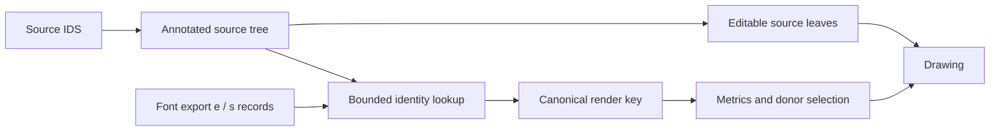

# Rendering normalization

[The normalizer](../src/composer/normalization.js) resolves font-export identities before metrics, learned features and donor ranking. An expanded operand such as `⿰口寸` uses the metrics of `吋` when the selected export explicitly maps that description to it. The source tree and its editable leaf order remain intact.



## Evidence and boundaries

- An export's `e` field supplies an encoded identity. Literal whole-node evidence takes precedence over a match obtained by contracting its children.
- An `s` decomposition supplies lookup evidence inside a compound. The search can expand one operand while retaining another contracted operand. An unsuccessful search leaves the source structure, with any proven child contractions, available for layout.
- A source atom retains its identity unless it has an explicit `e` mapping. Expanding and re-encoding a native character cannot silently change its metric donor.
- Operator notes and variation selectors participate in keys. Similar stroke inventories, character-variant relationships and component-family membership do not establish rendering identity.
- Excluded glyphs cannot become encoded targets. Their decompositions can still supply evidence for another compound.

A plan carries `source`, `key`, `node`, `encoded`, source-order `children`, and `capped`. Its child plans describe the original operands even when the whole node contracts to one glyph. Input arrays are never changed.

## Loading and bounds

Each composer pass has a normalizer. It permits at most 256 record callbacks across all lookups; positive records are shared, while absent records are reconsidered on the next call. Each resolution also has limits of 256 source/candidate node visits, depth 32 and 4096 work steps. Cyclic encoded chains provide no identity; repeated decomposition candidates are visited once.

The [loader](../src/composer/loader.js) discards provisional drawings while the source reports missing shards and creates a fresh composer after loading them. A capped lookup retains proven mappings and literal fallback geometry. `Drawing.normalization.capped` reports whether any lookup in the returned drawing reached a limit.

Preferred host queries use the canonical key and its positional forms. A cut indexed only under an input alias cannot become a spelling-dependent fallback. Unresolved structural keys remain available as written, and donor sibling keys normalize before exact-match ranking.

`separate` affects piece ownership, not normalization or parent metrics. Separate source leaves can still require different internal cuts; normalization alone does not provide a verified contour partition. Whole-body lookup and structural regrouping retain their existing rules, so this stage does not guarantee identical outlines for every equivalent spelling.

## Checks

```sh
bun test tests/render-normalization.test.js tests/composer-normalization.test.js
```

The integration fixture deliberately assigns unequal outline lengths to `吋` and the sum of `口` and `寸`. It checks parent allocation, feature records, preferred donor keys, exclusions, annotations and cold/warm loading. The evidence schema follows the pinned [han-compose export](https://github.com/mkpoli/han-compose/tree/bd0829b), whose record and shard fields are documented in the [loader](../src/composer/loader.js).
