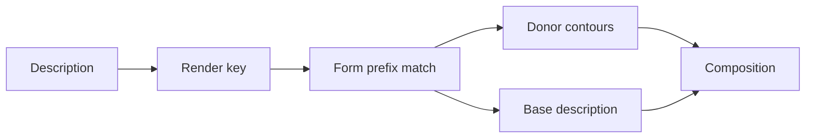

# Shared visual forms

Some descriptions name an intended component that no single encoded character supplies. [The visual-form registry](../src/composer/visual-forms.json) records those forms once, as donor outlines plus placement, and draws them wherever a matching description occurs.



## Matching

A form lists IDS prefixes. The prefix covers every operand above the base; the text after it is the base, parsed and drawn by the ordinary composer. A more specific prefix wins.

| Description | Prefix | Base |
| --- | --- | --- |
| `⿱⿻龶⿱乛丷吋` | `⿱⿻龶⿱乛丷` | `吋` |
| `⿳⿻韦丷一吋` | `⿳⿻韦丷一` | `吋` |
| `⿳⿱𰀁乛⿱⺌一⿰口寸` | `⿳⿱𰀁乛⿱⺌一` | `⿰口寸` |

The `⿱⿻韦丷` grouping describes a different form and has no entry. Operator annotations and variation selectors inside a prefix change the render key, so they do not match; the base keeps its own annotations and normalization.

## Donor pieces

Each face names a donor glyph and one contour of it, plus a box in a 1000-unit design frame. The contour keeps the face's stroke shapes and terminals; the box sets its size, so a non-uniform box changes the apparent weight. Pieces are `fixed`: the composer's density weighting does not thicken them into one another.

The hooked top uses these donors:

- `丨` supplies the straight stem.
- `三` supplies the three crossing bars.
- `乛` supplies the right-turning hook at the third bar.
- `丷` supplies the dot pair.
- `一` supplies the full-width base bar.

The base is drawn below the form from its normalized description. The form may stand over any base; the cited evidence covers the 口寸 and 吋 bases.

## Evidence and limits

The [MOE variant dictionary A00836-011](https://dict.variants.moe.edu.tw/dictView.jsp?ID=8882&q=1) records the manuscript witness (《碑別字新編》〈魏元騰墓誌〉). The [zi.tools outline](https://zi.tools/api/ids/lookupidsasync/%E2%BF%B1%E2%BF%BB%E9%BE%B6%E2%BF%B1%E4%B9%9B%E4%B8%B7%E5%90%8B?replace_token) and [GlyphWiki twedu-a00836-011](https://glyphwiki.org/json?name=twedu-a00836-011) are comparison witnesses; the zi.tools upstream revision is unspecified, and GlyphWiki's related U+2D260 lacks this hook.

Bar widths, stem length, hook placement, dot placement, and the donor contours are editorial. The form reproduces the arrangement, not a facsimile, and does not identify the character.

Only the sans and serif faces supply pieces; fangsong and kaisho fall back to ordinary composition. A donor the export lacks, or a base the composer cannot draw, is settled only when drawing, so layout selection can still prefer the form.

A separated drawing (`separate: true`) is not partitioned for these forms yet: its one-piece-per-leaf ownership would be invented. Such a request and the sketch preview fall back to ordinary composition, or to the cells layout for a dense description. An explicit cells layout is refused rather than silently drawing the description without the form. Exclusion of any donor also disables the form.

## Checks

```sh
bun test tests/visual-forms.test.js
bun scripts/render_before_after.mjs --out /tmp/form --cases cases.json --whole
```

The test covers accepted and rejected spellings, operator annotations and selectors in a prefix, both faces through a real composer, fixed pieces, the cells guard for a dense description under exclusion and under a face without pieces, normalized bases, separated drawings, donor exclusion, and a missing donor contour.
